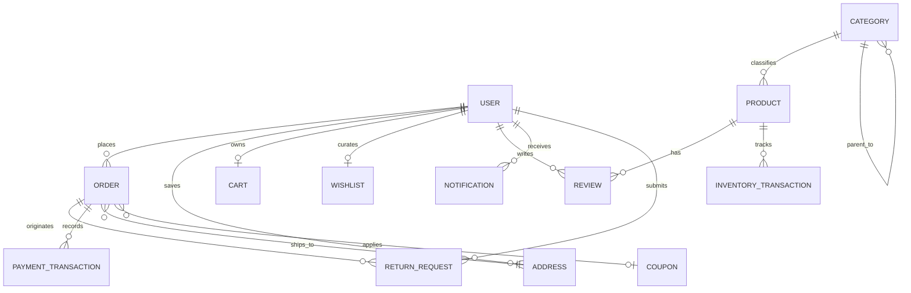

# SOLEVIBE — COMPLETE TECHNICAL ARCHITECTURE DOCUMENTATION

> **Document File:** `archetrect.md`  
> **Target Project:** SoleVibe Footwear E-Commerce Platform  
> **Status:** Authoritative Architectural Specification  
> **Inspection Date:** November 2026  
> **Environment:** Node.js v20+ / React 18 / Express 5 / MongoDB 8+

---

## Table of Contents
1. [Existing Technology Stack](#1-existing-technology-stack)
2. [Frontend Architecture](#2-frontend-architecture)
3. [Backend Architecture](#3-backend-architecture)
4. [Database Architecture & Mongoose Data Models](#4-database-architecture--mongoose-data-models)
5. [API Architecture & Endpoint Directory](#5-api-architecture--endpoint-directory)
6. [External Integrations & Provider Strategy](#6-external-integrations--provider-strategy)
7. [Security Architecture](#7-security-architecture)
8. [Integration with Future Design System (`design.md`)](#8-integration-with-future-design-system-designmd)
9. [Known Technical Limitations & Strategic Recommendations](#9-known-technical-limitations--strategic-recommendations)

---

## 1. Existing Technology Stack

SoleVibe is architected as a full-stack JavaScript/Node.js web application utilizing a monolithic codebase with a decoupled client-server runtime. The platform operates on standard MERN (MongoDB, Express, React, Node.js) foundational layers.

### 1.1 Core Stack Specifications

| Layer | Technology | Version | Purpose & Runtime Context |
| :--- | :--- | :--- | :--- |
| **Frontend Runtime** | React | `^18.2.0` | Declarative UI rendering, component state management, SPA views |
| **Frontend DOM** | React DOM | `^18.2.0` | Virtual DOM rendering to browser DOM tree |
| **Frontend Tooling** | `react-scripts` | `5.0.1` | Webpack 5 bundling, Babel compilation, dev server |
| **3D Rendering** | Three.js | `^0.186.0` | WebGL canvas rendering for 3D shoe models |
| **React 3D Bridge** | `@react-three/fiber` | `^8.15.0` | React renderer wrapper for Three.js |
| **React 3D Helpers**| `@react-three/drei` | `^9.88.0` | Orbit controls, staging, environment presets for 3D |
| **HTTP Client** | Axios | `^1.20.0` | Promise-based HTTP client with request/response interceptors |
| **Backend Runtime** | Node.js | `>=18.x` | Server-side execution environment |
| **Backend Framework**| Express | `^5.2.1` | REST API routing, controller execution, middleware pipelines |
| **Database ODM** | Mongoose | `^9.10.1` | MongoDB document schema modeling, validation, query engine |
| **Authentication** | JSON Web Token (`jsonwebtoken`) | `^9.0.3` | Cryptographic JWT token generation and Bearer verification |
| **Password Hashing** | `bcryptjs` | `^3.0.3` | Blowfish salt generation (work factor 12) & password hashing |
| **HTTP Security** | Helmet | `^8.3.0` | HTTP security headers, Cross-Origin Resource Policy (`cross-origin`) |
| **Cross-Origin** | CORS | `^2.8.6` | Dynamic origin whitelisting with credential propagation |
| **Environment** | Dotenv | `^17.4.2` | Loading environment configurations from project root `.env` |
| **File Handling** | Multer | `^2.5.0` | Multipart/form-data parsing with disk storage and type filters |
| **Email Gateway** | Nodemailer | `^10.6.1` | Transactional SMTP email delivery with HTML templating |
| **Payment Gateway** | Razorpay SDK | `^2.9.8` | Order initialization, payment verification, refund orchestration |
| **Process Control** | Concurrently | `^10.0.5` | Simultaneous execution of backend daemon and frontend dev server |
| **Dev Daemon** | Nodemon | `^3.1.14` | Hot-reloading file watcher for backend Node development |
| **Cross Platform** | `cross-env` | `^10.1.0` | Platform-agnostic shell environment variable assignment |

### 1.2 Technologies Verified as Absent
To prevent architectural assumptions, the following libraries are explicitly **not present** in the active codebase:
- **No `react-router-dom`:** Customer navigation is state-driven via the `currentPage` state hook in `App.js`.
- **No Redux / Zustand / Recoil:** Global state is maintained through root React state hooks and passed down via props.
- **No Tailwind CSS:** Styling is built with custom CSS modules, CSS custom properties (`design-tokens.css`), and global overrides.
- **No TypeScript:** The codebase is written entirely in standard ECMAScript / CommonJS (backend) and ES6 Modules (frontend).
- **No BullMQ / Redis:** Background schedulers (e.g., abandoned carts) run in-memory via Node `setInterval`.

---

## 2. Frontend Architecture

The frontend is a single-page application (SPA) designed with state-driven view orchestration, modular services, and tokenized CSS.

```
src/
├── components/                 # Page and reusable storefront UI components
│   ├── admin/                  # Administrative management sub-views
│   │   ├── AdminLayout.js / .css
│   │   ├── AdminSettings.js / .css
│   │   ├── CategoriesManager.js / .css
│   │   ├── ConfirmationModal.js / .css
│   │   ├── CouponsManager.js / .css
│   │   ├── CustomersManager.js / .css
│   │   ├── Dashboard.js / .css
│   │   ├── InventoryManager.js / .css
│   │   ├── OrdersManager.js / .css
│   │   ├── ProductFormModal.js / .css
│   │   ├── ProductsManager.js / .css
│   │   ├── ReturnsManager.js / .css
│   │   └── ReviewsManager.js / .css
│   ├── AddressBook.js / .css
│   ├── AddressForm.js
│   ├── AdminDashboard.js / .css
│   ├── Cart.js / .css
│   ├── CollectionPage.js / .css
│   ├── ConnectionStatus.js / .css
│   ├── CustomerAccount.js / .css
│   ├── CustomerSupportModal.js / .css
│   ├── FeedbackButton.js / .css
│   ├── Footer.js / .css
│   ├── Hero3D.js / .css
│   ├── HomePage.js / .css
│   ├── Login.js / .css
│   ├── Navbar.js / .css
│   ├── NotificationCenter.js / .css
│   ├── OrderConfirmation.js / .css
│   ├── OrderHistory.js / .css
│   ├── ProductCard.js
│   ├── ProductDetail.js / .css
│   ├── ProductShowcase.js / .css
│   ├── ProductSkeleton.js
│   ├── QuickViewModal.js / .css
│   ├── RecentlyViewed.js / .css
│   ├── Toast.js / .css
│   └── Wishlist.js / .css
├── config/
│   └── api.config.js           # API base URL and request timeout configurations
├── services/                   # Modular API service client layer (Axios)
│   ├── addressService.js
│   ├── analyticsService.js
│   ├── api.js                  # Axios singleton with interceptors & retry engine
│   ├── authService.js
│   ├── cartService.js
│   ├── categoryService.js
│   ├── couponService.js
│   ├── inventoryService.js
│   ├── notificationService.js
│   ├── orderService.js
│   ├── paymentService.js
│   ├── productService.js
│   ├── returnService.js
│   ├── reviewService.js
│   ├── settingsService.js
│   ├── uploadService.js
│   └── wishlistService.js
├── styles/
│   ├── design-tokens.css       # Core brand variables, colors, typography tokens
│   └── fashion-overrides.css   # Kinetic styling overrides, luxury editorial rules
├── utils/
│   └── initializeAdmin.js      # Bootstrap utility for initial administrative setup
├── App.js                      # Root component, state orchestration, route switching
├── App.css                     # Global utility and application-level styles
├── index.js                    # Webpack/React DOM client root bootstrap
└── index.css                   # Base HTML resets, font imports
```

### 2.1 Main Application Entry Points
1. **`src/index.js`:** Bootstraps the React DOM root (`ReactDOM.createRoot(document.getElementById('root'))`) and mounts `<App />` within `<React.StrictMode>`.
2. **`src/App.js`:** The central controller of the client application. It manages:
   - User authentication state (`isAuthenticated`, `userType`, `currentUser`).
   - Portal mode: Detection of `/admin` vs storefront mode via `window.location.pathname`.
   - Page view switching (`currentPage` state: `home`, `shop`, `men`, `women`, `running`, `training`, `trail`, `racing`, `sale`, `accessories`, `ozark`, `cart`, `wishlist`, `orders`, `addresses`, `account`, `login`).
   - Selected entity state: `selectedProduct` for detail views, `quickViewProduct` for modal previews, and `completedOrder` for confirmation receipts.
   - Global feedback state: Toast notifications (`toast`) and connection state detection (`ConnectionStatus`).

### 2.2 Navigation & Routing Architecture
- **Customer Storefront:** Employs a state-driven navigation pattern. Invoking `setCurrentPage(pageKey)` updates the view rendered inside `App.js`. This eliminates external routing library dependencies and enables instant view transitions.
- **Admin Portal Routing:** Direct pathname inspection:
  ```javascript
  const path = window.location.pathname;
  setIsAdminRoute(path === '/admin');
  ```
  When navigating to `/admin`, `App.js` renders `AdminDashboard`, provided the user holds the `ADMIN` role. If unauthenticated, it presents the administrative authentication modal.
- **Custom DOM Event Bus:** Decoupled components communicate via browser events:
  - `window.dispatchEvent(new CustomEvent('openProductDetail', { detail: product }))`: Allows nested components like `RecentlyViewed` or `ProductCard` to command `App.js` to open the full product detail view without prop drilling.

### 2.3 State Management & Data Synchronization
- **Guest-to-User State Synchronization:**
  - When unauthenticated, user cart items and wishlist items are persisted to `localStorage` under keys `cart-guest` and `wishlist-guest`.
  - Upon successful customer login, `loadUserData` in `App.js` checks for guest items. It transparently executes bulk synchronization to the MongoDB backend via `cartService.addToCart()` and `wishlistService.addToWishlist()`, subsequently clearing the guest storage keys.
- **API Service Layer Pattern:**
  - All network communication is routed through `src/services/api.js`.
  - `api.js` configures an Axios instance with automatic JWT Bearer token attachment via request interceptors:
    ```javascript
    api.interceptors.request.use(async (config) => {
      const auth = localStorage.getItem('auth');
      if (auth) {
        const { token } = JSON.parse(auth);
        if (token) config.headers.Authorization = `Bearer ${token}`;
      }
      return config;
    });
    ```
  - **Connection Resilience:** `api.js` includes automated retry logic with exponential backoff (`MAX_RETRIES = 3`, `RETRY_DELAY = 2000ms`) targeting network dropouts (`ECONNREFUSED`, `ERR_NETWORK`).

---

## 3. Backend Architecture

The backend is built as an Express 5 REST API designed around standard Model-View-Controller (MVC) and service-layer patterns.

```
server/
├── config/
│   └── db.js                   # Mongoose connection manager with state telemetry
├── controllers/                # 18 Express controller modules handling business logic
├── middleware/
│   ├── authMiddleware.js       # JWT authentication and RBAC authorization
│   ├── errorMiddleware.js      # Global error handling and 404 middleware
│   └── uploadMiddleware.js     # Multer storage configuration and file validation
├── models/                     # 14 Mongoose Schema definitions
├── routes/                     # 18 Express Router endpoint declarations
├── services/                   # Reusable business logic, email, payments, logistics
│   ├── shippingProviders/      # Multi-carrier shipping provider factory
│   │   ├── BaseCourierProvider.js
│   │   ├── DelhiveryProvider.js
│   │   ├── MockCourierProvider.js
│   │   ├── ShiprocketProvider.js
│   │   └── index.js
│   ├── abandonedCartService.js # In-memory scheduled abandoned cart scanning
│   ├── emailService.js         # Nodemailer SMTP with branded HTML templates
│   ├── notificationService.js  # Customer and admin system notifications
│   ├── razorpayService.js      # Razorpay payment gateway integration
│   └── shippingService.js      # Server-side shipping calculation and zone matching
└── server.js                   # Main application entry point and server lifecycle
```

### 3.1 Server Startup & Lifecycle (`server/server.js`)
1. **Environment Initialization:** Loads `.env` from the project root using `dotenv.config({ path: path.resolve(__dirname, '../.env') })`.
2. **Security Headers:** Configures `helmet` with `crossOriginResourcePolicy: { policy: "cross-origin" }` to permit cross-origin image asset consumption.
3. **CORS Whitelist:** Explicitly allows localhost ports (`3000`, `3001`, `3002`) and local network IP addresses (`192.168.29.21`) with `credentials: true`.
4. **Body Parsing:** Registers `express.json({ limit: '10mb' })` and `express.urlencoded({ extended: true, limit: '10mb' })` to support image base64 uploads and large order payloads.
5. **Static File Server:** Mounts `/uploads` to serve uploaded product images from `public/uploads`.
6. **Database Connection:** Invokes `connectDB()` via `server/config/db.js`.
7. **Route Mounting:** Mounts all 18 route files under standard `/api/*` endpoints.
8. **Health Check:** Exposes `/api/health` providing database connectivity status and server uptime telemetry.
9. **Error Handling Pipeline:** Registers `errorMiddleware` as the terminal pipeline handler.
10. **Background Services:** Starts the `abandonedCartScheduler` upon successful HTTP listener binding on `0.0.0.0:5001`.

### 3.2 Authentication & Authorization Pipeline
- **Authentication Middleware (`authenticate`):**
  - Extracts the JWT from the `Authorization: Bearer <token>` header.
  - Verifies token signature against `process.env.JWT_SECRET`.
  - Queries `User.findById(decoded.id).select('-password')`.
  - Verifies user exists and `isActive === true`.
  - Attaches authenticated user document to `req.user`.
- **Role-Based Authorization Middleware (`authorize(...roles)`):**
  - Evaluates `roles.includes(req.user.role)`.
  - Rejects unauthorized requests with HTTP `403 Forbidden` (`Required role: ADMIN`).

---

## 4. Database Architecture & Mongoose Data Models

The database tier is powered by MongoDB and modeled with Mongoose. The database name is `kinetic_stride` (or configured via `MONGO_URI`).



### 4.1 Exhaustive Model Reference

#### 1. User Model (`server/models/User.js`)
- **Purpose:** Manages customer and administrator profiles, credentials, and access roles.
- **Fields:**
  - `name`: `String`, required, trimmed.
  - `email`: `String`, required, unique, lowercase, trimmed.
  - `password`: `String`, required, min length 6, excluded by default (`select: false`).
  - `role`: `String`, enum `['USER', 'ADMIN']`, default `'USER'`.
  - `isActive`: `Boolean`, default `true`.
  - `timestamps`: `true` (`createdAt`, `updatedAt`).
- **Indexes:**
  - `{ email: 1 }` (unique).
  - `{ role: 1, createdAt: -1 }`.
- **Hooks & Methods:**
  - Pre-save hook: Salts and hashes passwords with `bcrypt.hash(pwd, 12)` if modified.
  - `comparePassword(candidate)`: Validates passwords using `bcrypt.compare`.

#### 2. Product Model (`server/models/Product.js`)
- **Purpose:** Central footwear catalog entity defining biomechanical specs, pricing, stock, and imagery.
- **Fields:**
  - `name`: `String`, required, trimmed.
  - `slug`: `String`, unique, trimmed.
  - `sku`: `String`, unique, sparse, trimmed.
  - `brand`: `String`, default `'SoleVibe'`, trimmed.
  - `category`: `String`, enum `['men', 'women', 'unisex']`, required.
  - `gender`: `String`, enum `['men', 'women', 'unisex']`, default `'unisex'`.
  - `productType`: `String`, trimmed (e.g., `'running'`, `'trail'`).
  - `collectionName`: `String`, trimmed.
  - `price`: `Number`, required, min 0.
  - `originalPrice`: `Number`, min 0.
  - `discount`: `Number`, min 0, max 100.
  - `description`: `String`, required.
  - `image`: `String`, required (hero thumbnail URL).
  - `images`: `[String]`, default `[]` (gallery image URLs).
  - `sizes`: `[String]`, default `[]` (e.g., `['UK 7', 'UK 8', 'UK 9']`).
  - `colors`: `[String]`, default `[]`.
  - `specifications`: Subdocument `{ weight, drop, energy, material, sole, closure, type, use }`.
  - `features`: `[String]`, default `[]`.
  - `badge`: `String` (e.g., `'NEW'`, `'BESTSELLER'`).
  - `badgeColor`: `String`.
  - `stock`: `Number`, default 0, min 0.
  - `featured`: `Boolean`, default `false`.
  - `isNew`: `Boolean`, default `false`.
  - `onSale`: `Boolean`, default `false`.
  - `rating`: `Number`, default 0, min 0, max 5.
  - `reviewCount`: `Number`, default 0, min 0.
  - `status`: `String`, enum `['active', 'inactive', 'discontinued']`, default `'active'`.
  - `timestamps`: `true`.
- **Indexes:**
  - `{ slug: 1 }` (unique).
  - `{ sku: 1 }` (unique, sparse).
  - `{ status: 1, category: 1 }`.
  - `{ status: 1, featured: 1 }`.
  - `{ status: 1, price: 1 }`.
  - `{ status: 1, createdAt: -1 }`.
  - `{ name: 'text', description: 'text', brand: 'text' }` (Full-text search).
- **Hooks:**
  - Pre-save hook: Automatically generates unique URL-friendly `slug` from name.
  - Pre-save hook: Automatically generates structured `sku` (e.g., `SV-M-001`) if omitted.

#### 3. Category Model (`server/models/Category.js`)
- **Purpose:** Hierarchical taxonomy for products with SEO metadata and subcategories.
- **Fields:**
  - `name`: `String`, required, max length 100, trimmed.
  - `slug`: `String`, unique, trimmed, lowercase.
  - `description`: `String`, default `''`.
  - `image`: `String`, default `''`.
  - `icon`: `String`, default `'👟'`.
  - `color`: `String`, default `'#c9232d'`.
  - `parentCategory`: `ObjectId`, ref `'Category'`, default `null`.
  - `subcategories`: `[String]`, default `[]`.
  - `isActive`: `Boolean`, default `true`.
  - `featured`: `Boolean`, default `false`.
  - `displayOrder`: `Number`, default 0.
  - `seoTitle`: `String`, default `''`.
  - `seoDescription`: `String`, default `''`.
  - `timestamps`: `true`.
- **Indexes:**
  - `{ slug: 1 }` (unique).
  - `{ isActive: 1, displayOrder: 1 }`.

#### 4. Order Model (`server/models/Order.js`)
- **Purpose:** Transactional record of completed purchases, payment state, and shipping fulfillment.
- **Fields:**
  - `user`: `ObjectId`, ref `'User'`, required.
  - `items`: Array of `{ product: ObjectId, name: String, image: String, price: Number, quantity: Number, size: String }`.
  - `subtotal`: `Number`, required, min 0.
  - `discount`: `Number`, default 0, min 0.
  - `shipping`: `Number`, default 0, min 0.
  - `shippingMethod`: `String`, default `'standard'`.
  - `shippingMethodName`: `String`, default `'Standard Shipping'`.
  - `shippingZone`: `String`, default `'NATIONAL'`.
  - `estimatedDeliveryRange`: `String`, default `'3-5 business days'`.
  - `shipmentReferenceId`: `String`, sparse.
  - `shippingAddress`: `Mixed` (Snapshot of full customer address at checkout).
  - `promoCode`: `String`.
  - `coupon`: Object `{ code, discountType, discountValue, discountAmount }`.
  - `notes`: `String`.
  - `payment`: Object `{ provider: 'RAZORPAY', razorpayOrderId: String, razorpayPaymentId: String, status: ['PENDING', 'CREATED', 'PAID', 'FAILED', 'CANCELLED'], amount: Number, currency: 'INR', paidAt: Date }`.
  - `status`: `String`, enum `['confirmed', 'processing', 'shipped', 'out_for_delivery', 'delivered', 'cancelled']`, default `'confirmed'`.
  - `statusHistory`: Array of `{ status: String, note: String, changedBy: ObjectId, changedAt: Date }`.
  - `trackingNumber`: `String`, default `''`.
  - `carrier`: `String`, default `''`.
  - `shippedAt`: `Date`.
  - `estimatedDeliveryDate`: `Date`.
  - `timestamps`: `true`.
- **Indexes:**
  - `{ 'payment.razorpayPaymentId': 1 }` (unique, sparse).
  - `{ user: 1, createdAt: -1 }`.
  - `{ status: 1, createdAt: -1 }`.
- **Virtuals:**
  - `total`: Calculates `subtotal - discount + shipping`.

#### 5. Address Model (`server/models/Address.js`)
- **Purpose:** Stores customer delivery addresses with strict Indian PIN and phone validation.
- **Fields:**
  - `user`: `ObjectId`, ref `'User'`, required.
  - `type`: `String`, enum `['HOME', 'OFFICE', 'OTHER']`, default `'HOME'`.
  - `fullName`: `String`, required, trimmed.
  - `phone`: `String`, required, validated against `/^(?:\+91|91|0)?[6-9]\d{9}$/`.
  - `addressLine1`: `String`, required, trimmed.
  - `addressLine2`: `String`, trimmed.
  - `landmark`: `String`, trimmed.
  - `city`: `String`, required, trimmed.
  - `state`: `String`, required, trimmed.
  - `postalCode`: `String`, required, validated against `/^\d{6}$/` (6-digit Indian PIN).
  - `country`: `String`, required, trimmed (default `'India'`).
  - `isDefault`: `Boolean`, default `false`.
  - `timestamps`: `true`.
- **Indexes:**
  - `{ user: 1, isDefault: 1 }`.

#### 6. Cart Model (`server/models/Cart.js`)
- **Purpose:** Server-side persistent cart storage for authenticated customers.
- **Fields:**
  - `user`: `ObjectId`, ref `'User'`, required, unique.
  - `items`: Array of `{ product: ObjectId ref 'Product', quantity: Number, size: String }`.
  - `timestamps`: `true`.
- **Indexes:**
  - `{ user: 1 }` (unique).

#### 7. Wishlist Model (`server/models/Wishlist.js`)
- **Purpose:** Customer saved products and favorites.
- **Fields:**
  - `user`: `ObjectId`, ref `'User'`, required, unique.
  - `items`: Array of `{ product: ObjectId ref 'Product' }`.
  - `timestamps`: `true`.
- **Indexes:**
  - `{ user: 1 }` (unique).

#### 8. Coupon Model (`server/models/Coupon.js`)
- **Purpose:** Promotional discounts, percentage/fixed vouchers, validation thresholds.
- **Fields:**
  - `code`: `String`, required, unique, uppercase, trimmed.
  - `description`: `String`, default `''`.
  - `discountType`: `String`, enum `['PERCENTAGE', 'FIXED']`, required.
  - `discountValue`: `Number`, required, min 0.01.
  - `maxDiscount`: `Number`, min 0.
  - `minimumOrderValue`: `Number`, default 0, min 0.
  - `startDate`: `Date`, default `Date.now`.
  - `expiryDate`: `Date`.
  - `usageLimit`: `Number`, min 1.
  - `usageCount`: `Number`, default 0.
  - `perUserLimit`: `Number`, default 1.
  - `applicableProducts`: `[ObjectId ref 'Product']`.
  - `applicableCategories`: `[String]`.
  - `isActive`: `Boolean`, default `true`.
  - `timestamps`: `true`.
- **Indexes:**
  - `{ code: 1 }` (unique).

#### 9. InventoryTransaction Model (`server/models/InventoryTransaction.js`)
- **Purpose:** Immutable audit ledger for every stock alteration (purchases, adjustments, returns).
- **Fields:**
  - `product`: `ObjectId`, ref `'Product'`, required.
  - `sku`: `String`, trimmed.
  - `type`: `String`, enum `['STOCK_IN', 'STOCK_OUT', 'ADJUSTMENT', 'RETURN', 'ORDER', 'DAMAGE', 'CORRECTION']`, required.
  - `quantity`: `Number`, required.
  - `previousStock`: `Number`, required, min 0.
  - `newStock`: `Number`, required, min 0.
  - `reason`: `String`, required, trimmed.
  - `note`: `String`, default `''`.
  - `referenceType`: `String`, enum `['ORDER', 'RETURN', 'ADMIN', 'SYSTEM']`, default `'ADMIN'`.
  - `referenceId`: `String`, default `''`.
  - `changedBy`: `ObjectId`, ref `'User'`.
  - `timestamps`: `true`.
- **Indexes:**
  - `{ product: 1, createdAt: -1 }`.
  - `{ type: 1, createdAt: -1 }`.

#### 10. Notification Model (`server/models/Notification.js`)
- **Purpose:** In-app real-time event notifications for customers and administrators.
- **Fields:**
  - `recipient`: `ObjectId`, ref `'User'`, required.
  - `recipientRole`: `String`, enum `['USER', 'ADMIN']`, default `'USER'`.
  - `type`: `String`, required (e.g., `'ORDER_CONFIRMED'`, `'ABANDONED_CART'`, `'LOW_STOCK'`).
  - `title`: `String`, required.
  - `message`: `String`, required.
  - `relatedResourceType`: `String`, enum `['ORDER', 'PAYMENT', 'RETURN', 'CART', 'PRODUCT', 'SYSTEM']`.
  - `relatedResourceId`: `String`, default `''`.
  - `metadata`: `Mixed`.
  - `isRead`: `Boolean`, default `false`.
  - `readAt`: `Date`.
  - `referenceId`: `String` (Used for deduplication of cart alerts).
  - `timestamps`: `true`.
- **Indexes:**
  - `{ recipient: 1, createdAt: -1 }`.
  - `{ recipient: 1, isRead: 1 }`.
  - `{ type: 1 }`.
  - `{ referenceId: 1 }` (unique, sparse).
  - `{ createdAt: 1 }` (TTL: `expireAfterSeconds: 7776000` / 90 days retention).

#### 11. PaymentTransaction Model (`server/models/PaymentTransaction.js`)
- **Purpose:** Complete payment lifecycle audit record, capturing Razorpay order, payment, and refund states.
- **Fields:**
  - `order`: `ObjectId`, ref `'Order'`.
  - `user`: `ObjectId`, ref `'User'`.
  - `razorpayOrderId`: `String`, required, indexed.
  - `razorpayPaymentId`: `String`, sparse, indexed.
  - `razorpaySignature`: `String`.
  - `amount`: `Number`, required, min 0.
  - `currency`: `String`, default `'INR'`.
  - `status`: `String`, enum `['INITIATED', 'AUTHORIZED', 'CAPTURED', 'SUCCESS', 'FAILED', 'REFUNDED', 'PENDING']`, default `'INITIATED'`.
  - `paymentMethod`: `String`, default `'razorpay'`.
  - `webhookEvent`: `String`.
  - `webhookEventId`: `String`, sparse, unique (Enforces webhook idempotency).
  - `failureReason`: `String`.
  - `errorCode`: `String`.
  - `errorDescription`: `String`.
  - `refund`: Object `{ refundId, amount, status, initiatedAt, completedAt }`.
  - `metadata`: `Mixed`.
  - `timestamps`: `true`.
- **Indexes:**
  - `{ razorpayOrderId: 1, status: 1 }`.
  - `{ user: 1, createdAt: -1 }`.
  - `{ webhookEventId: 1 }` (unique, sparse).

#### 12. ReturnRequest Model (`server/models/ReturnRequest.js`)
- **Purpose:** Tracks customer product return submissions, RMA inspection statuses, and refund processing.
- **Fields:**
  - `user`: `ObjectId`, ref `'User'`, required.
  - `order`: `ObjectId`, ref `'Order'`, required.
  - `items`: Array of `{ product: ObjectId, name: String, quantity: Number, price: Number, reason: String, itemAmount: Number }`.
  - `reason`: `String`, enum `['WRONG_SIZE', 'WRONG_PRODUCT', 'DAMAGED', 'DEFECTIVE', 'NOT_AS_DESCRIBED', 'QUALITY_ISSUE', 'CHANGED_MIND', 'OTHER']`.
  - `description`: `String`, default `''`.
  - `images`: `[String]` (Customer uploaded evidence photos).
  - `status`: `String`, enum `['REQUESTED', 'APPROVED', 'REJECTED', 'RECEIVED', 'REFUND_PENDING', 'REFUNDED', 'CANCELLED']`, default `'REQUESTED'`.
  - `refund`: Object `{ amount: Number, status: ['PENDING', 'INITIATED', 'COMPLETED', 'FAILED'], razorpayRefundId: String, initiatedAt: Date, completedAt: Date }`.
  - `adminNote`: `String`.
  - `statusHistory`: Array of `{ status: String, note: String, changedBy: ObjectId, changedAt: Date }`.
  - `timestamps`: `true`.
- **Indexes:**
  - `{ user: 1, createdAt: -1 }`.
  - `{ order: 1 }`.
  - `{ status: 1 }`.

#### 13. Review Model (`server/models/Review.js`)
- **Purpose:** Customer product feedback, 1-to-5 star ratings, and moderation workflow.
- **Fields:**
  - `user`: `ObjectId`, ref `'User'`, required.
  - `product`: `ObjectId`, ref `'Product'`, required.
  - `order`: `ObjectId`, ref `'Order'`.
  - `rating`: `Number`, required, integer, min 1, max 5.
  - `title`: `String`, required, max length 100.
  - `comment`: `String`, required, max length 1000.
  - `isVerifiedPurchase`: `Boolean`, default `false`.
  - `status`: `String`, enum `['pending', 'approved', 'rejected']`, default `'approved'`.
  - `helpfulVotes`: `Number`, default 0.
  - `timestamps`: `true`.
- **Indexes:**
  - `{ user: 1, product: 1 }` (unique — prevents duplicate reviews per user/product).
  - `{ product: 1, status: 1 }`.

#### 14. Settings Model (`server/models/Settings.js`)
- **Purpose:** Store-wide operational configuration persisted in database (singleton document pattern).
- **Fields:**
  - `storeName`: `String`, default `'SoleVibe Footwear'`.
  - `tagline`: `String`, default `'Engineered For Peak Biomechanical Motion'`.
  - `supportEmail`: `String`, default `'support@solevibe.com'`.
  - `contactPhone`: `String`, default `'+91 1800-765-3842'`.
  - `storeAddress`: Object `{ street, city, state, postalCode, country }`.
  - `currencyCode`: `String`, default `'INR'`.
  - `currencySymbol`: `String`, default `'₹'`.
  - `freeShippingThreshold`: `Number`, default `2000`.
  - `standardShippingRate`: `Number`, default `150`.
  - `expressShippingRate`: `Number`, default `350`.
  - `taxRate`: `Number`, default `18` (GST percent).
  - `orderPrefix`: `String`, default `'SV-'`.
  - `maintenanceMode`: `Boolean`, default `false`.
  - `allowGuestCheckout`: `Boolean`, default `false`.
  - `inventoryThresholds`: Object `{ lowStockAlert: 10, outOfStockAlert: 0 }`.
  - `socialLinks`: Object `{ instagram, twitter, facebook, youtube }`.
  - `timestamps`: `true`.

---

## 5. API Architecture & Endpoint Directory

All endpoints are hosted under `/api`. All protected endpoints require a valid JWT passed in the HTTP header:  
`Authorization: Bearer <jwt-token>`

### 5.1 Authentication Endpoints (`/api/auth`)
| Method | Endpoint | Access Level | Description & Controller Action |
| :--- | :--- | :--- | :--- |
| `POST` | `/api/auth/register` | Public | Register new customer account (`authController.register`) |
| `POST` | `/api/auth/login` | Public | Authenticate credentials and issue JWT (`authController.login`) |
| `GET` | `/api/auth/me` | Authenticated | Retrieve authenticated user profile (`authController.getMe`) |
| `PUT` | `/api/auth/profile` | Authenticated | Update user name and profile info (`authController.updateProfile`) |
| `PUT` | `/api/auth/update-password` | Authenticated | Verify old password and set new password (`authController.updatePassword`) |

### 5.2 Product Catalog Endpoints (`/api/products`)
| Method | Endpoint | Access Level | Description & Controller Action |
| :--- | :--- | :--- | :--- |
| `GET` | `/api/products` | Public | Query catalog with filtering, sorting, pagination, search (`getProducts`) |
| `GET` | `/api/products/:id` | Public | Fetch product by MongoDB ID or unique slug (`getProduct`) |
| `POST` | `/api/products` | Admin Only | Create new product with automatic SKU/slug (`createProduct`) |
| `PUT` | `/api/products/:id` | Admin Only | Update existing product details (`updateProduct`) |
| `PUT` | `/api/products/:id/status`| Admin Only | Toggle active, inactive, or discontinued status (`updateProductStatus`) |
| `DELETE`| `/api/products/:id` | Admin Only | Remove product from catalog (`deleteProduct`) |

### 5.3 Category Endpoints (`/api/categories`)
| Method | Endpoint | Access Level | Description & Controller Action |
| :--- | :--- | :--- | :--- |
| `GET` | `/api/categories` | Public | List all categories with product counts and hierarchy (`getCategories`) |
| `GET` | `/api/categories/:identifier`| Public | Fetch category by slug or ID (`getCategory`) |
| `POST` | `/api/categories` | Admin Only | Create category with slug generation (`createCategory`) |
| `PUT` | `/api/categories/:id` | Admin Only | Update category name, image, description, SEO (`updateCategory`) |
| `PUT` | `/api/categories/:id/status`| Admin Only | Toggle category `isActive` state (`toggleCategoryStatus`) |
| `DELETE`| `/api/categories/:id` | Admin Only | Remove category from database (`deleteCategory`) |

### 5.4 Cart Endpoints (`/api/cart`)
| Method | Endpoint | Access Level | Description & Controller Action |
| :--- | :--- | :--- | :--- |
| `GET` | `/api/cart` | Authenticated | Retrieve user cart populated with product details (`getCart`) |
| `POST` | `/api/cart` | Authenticated | Add item (with size) or increment quantity (`addToCart`) |
| `PUT` | `/api/cart/:itemId` | Authenticated | Update quantity of a specific cart item (`updateCartItem`) |
| `DELETE`| `/api/cart/:itemId` | Authenticated | Remove an item from cart (`removeCartItem`) |
| `DELETE`| `/api/cart` | Authenticated | Clear all items from user cart (`clearCart`) |

### 5.5 Wishlist Endpoints (`/api/wishlist`)
| Method | Endpoint | Access Level | Description & Controller Action |
| :--- | :--- | :--- | :--- |
| `GET` | `/api/wishlist` | Authenticated | Retrieve user wishlist with populated products (`getWishlist`) |
| `POST` | `/api/wishlist` | Authenticated | Add product to wishlist (`addToWishlist`) |
| `DELETE`| `/api/wishlist/:productId`| Authenticated | Remove product from wishlist (`removeFromWishlist`) |
| `DELETE`| `/api/wishlist` | Authenticated | Clear all items from wishlist (`clearWishlist`) |

### 5.6 Address Book Endpoints (`/api/addresses`)
| Method | Endpoint | Access Level | Description & Controller Action |
| :--- | :--- | :--- | :--- |
| `GET` | `/api/addresses` | Authenticated | List all saved delivery addresses for user (`getAddresses`) |
| `POST` | `/api/addresses` | Authenticated | Create address with PIN and phone validation (`createAddress`) |
| `PUT` | `/api/addresses/:id` | Authenticated | Update address details (`updateAddress`) |
| `DELETE`| `/api/addresses/:id` | Authenticated | Delete address and promote next default if needed (`deleteAddress`) |
| `PUT` | `/api/addresses/:id/default`| Authenticated | Set address as primary default (`setDefaultAddress`) |
| `PATCH`| `/api/addresses/:id/default`| Authenticated | HTTP PATCH alias for setting default address (`setDefaultAddress`) |

### 5.7 Order Fulfillment Endpoints (`/api/orders`)
| Method | Endpoint | Access Level | Description & Controller Action |
| :--- | :--- | :--- | :--- |
| `POST` | `/api/orders` | Authenticated | Create order, deduct inventory, trigger confirmation (`createOrder`) |
| `GET` | `/api/orders` | Authenticated | Retrieve order history for logged-in user (`getOrders`) |
| `GET` | `/api/orders/:id` | Authenticated | Fetch single order by ID with address snapshot (`getOrder`) |
| `GET` | `/api/orders/admin/all` | Admin Only | Paginated, filterable list of all store orders (`getAllOrders`) |
| `PUT` | `/api/orders/:id/status`| Admin Only | Update fulfillment status with statusHistory (`updateOrderStatus`) |
| `DELETE`| `/api/orders/:id` | Admin Only | Delete order record (`deleteOrder`) |

### 5.8 Payments & Gateway Endpoints (`/api/payment`)
| Method | Endpoint | Access Level | Description & Controller Action |
| :--- | :--- | :--- | :--- |
| `POST` | `/api/payment/create-order` | Authenticated | Create Razorpay order ID in paise (`createPaymentOrder`) |
| `POST` | `/api/payment/verify` | Authenticated | Verify HMAC SHA256 payment signature (`verifyPayment`) |
| `POST` | `/api/payment/webhook` | Public / Gateway | Razorpay webhook callback with signature verification (`handleRazorpayWebhook`) |

### 5.9 Logistics & Shipping Endpoints (`/api/shipping`)
| Method | Endpoint | Access Level | Description & Controller Action |
| :--- | :--- | :--- | :--- |
| `GET` | `/api/shipping/methods` | Public | Retrieve active shipping delivery options (`getShippingMethods`) |
| `POST` | `/api/shipping/calculate` | Public | Calculate fee and delivery dates from PIN/subtotal (`calculateShippingFee`) |
| `POST` | `/api/shipping/webhook` | Public / Courier | Carrier webhook for automated tracking updates (`handleShippingWebhook`) |

### 5.10 Customer Administration Endpoints (`/api/users` & `/api/admin/customers`)
| Method | Endpoint | Access Level | Description & Controller Action |
| :--- | :--- | :--- | :--- |
| `GET` | `/api/users` | Admin Only | Retrieve all customer accounts with order metrics (`getUsers`) |
| `GET` | `/api/users/:id` | Admin Only | Fetch detailed user profile and order history (`getUser`) |
| `PUT` | `/api/users/:id/status` | Admin Only | Activate or suspend user account (`updateUserStatus`) |
| `PUT` | `/api/users/:id` | Admin Only | Update customer account details (`updateUser`) |
| `DELETE`| `/api/users/:id` | Admin Only | Delete customer account (`deleteUser`) |

### 5.11 Inventory Management Endpoints (`/api/admin/inventory`)
| Method | Endpoint | Access Level | Description & Controller Action |
| :--- | :--- | :--- | :--- |
| `GET` | `/api/admin/inventory` | Admin Only | Inventory stock overview for all catalog items (`getInventory`) |
| `GET` | `/api/admin/inventory/low-stock`| Admin Only | Filter items at or below low stock threshold (`getLowStockProducts`) |
| `GET` | `/api/admin/inventory/:productId`| Admin Only| Get detailed inventory metrics for single product (`getProductInventory`) |
| `POST` | `/api/admin/inventory/:productId/adjust`| Admin Only| Adjust stock levels and record audit transaction (`adjustStock`) |
| `PUT` | `/api/admin/inventory/:productId`| Admin Only| Alias for stock adjustment (`adjustStock`) |
| `GET` | `/api/admin/inventory/:productId/history`| Admin Only| Retrieve complete transaction ledger for product (`getInventoryHistory`) |

### 5.12 Analytics Endpoints (`/api/admin/analytics`)
| Method | Endpoint | Access Level | Description & Controller Action |
| :--- | :--- | :--- | :--- |
| `GET` | `/api/admin/analytics/overview` | Admin Only | Revenue, order counts, customer totals, low stock (`getOverview`) |
| `GET` | `/api/admin/analytics/sales-trend`| Admin Only | Daily/monthly revenue and volume time series (`getSalesTrend`) |
| `GET` | `/api/admin/analytics/top-products`| Admin Only| Highest selling products by volume and revenue (`getTopProducts`) |
| `GET` | `/api/admin/analytics/category-performance`| Admin Only| Revenue distribution across categories (`getCategoryPerformance`) |
| `GET` | `/api/admin/analytics/customer-stats`| Admin Only| Customer acquisition and repeat buyer rates (`getCustomerStats`) |
| `GET` | `/api/admin/analytics/coupon-stats`| Admin Only | Coupon utilization rates and total discounts (`getCouponStats`) |
| `GET` | `/api/admin/analytics/returns-stats`| Admin Only | RMA return rates categorized by reason (`getReturnsStats`) |
| `GET` | `/api/admin/analytics/inventory-stats`| Admin Only| Valuation of inventory and stock health (`getInventoryStats`) |
| `GET` | `/api/admin/analytics/export` | Admin Only | Export analytical data in CSV/JSON format (`exportReport`) |

### 5.13 Coupon Management Endpoints (`/api/coupons`)
| Method | Endpoint | Access Level | Description & Controller Action |
| :--- | :--- | :--- | :--- |
| `POST` | `/api/coupons/validate` | Optional Auth | Check coupon eligibility, expiry, min order value (`validateCouponCustomer`) |
| `GET` | `/api/coupons/admin/all` | Admin Only | Retrieve all promotional coupons (`getAllCouponsAdmin`) |
| `POST` | `/api/coupons/admin` | Admin Only | Create new percentage or fixed coupon (`createCouponAdmin`) |
| `PUT` | `/api/coupons/admin/:id` | Admin Only | Update coupon parameters or active status (`updateCouponAdmin`) |
| `DELETE`| `/api/coupons/admin/:id` | Admin Only | Delete coupon from database (`deleteCouponAdmin`) |

### 5.14 Returns & Refunds Endpoints (`/api/returns`)
| Method | Endpoint | Access Level | Description & Controller Action |
| :--- | :--- | :--- | :--- |
| `POST` | `/api/returns` | Authenticated | Submit return request for delivered order (`createReturnRequest`) |
| `GET` | `/api/returns/my` | Authenticated | Retrieve return history for current user (`getMyReturns`) |
| `GET` | `/api/returns/:id` | Authenticated | Retrieve return status and inspection details (`getReturnById`) |
| `PUT` | `/api/returns/:id/cancel`| Authenticated | Customer cancellation of pending return (`cancelReturnRequest`) |
| `GET` | `/api/returns/admin/all` | Admin Only | Admin view of all customer return requests (`getAllReturnsAdmin`) |
| `PUT` | `/api/returns/admin/:id/status`| Admin Only | Update return status (`APPROVED`, `REJECTED`, etc.) (`updateReturnStatusAdmin`) |
| `POST` | `/api/returns/admin/:id/refund`| Admin Only | Process Razorpay refund for approved return (`processReturnRefundAdmin`) |

### 5.15 Product Reviews Endpoints (`/api/reviews`)
| Method | Endpoint | Access Level | Description & Controller Action |
| :--- | :--- | :--- | :--- |
| `GET` | `/api/reviews/product/:productId`| Public | List approved customer reviews for a product (`getProductReviews`) |
| `GET` | `/api/reviews/my/:productId` | Authenticated | Retrieve user's existing review for product (`getMyReview`) |
| `POST` | `/api/reviews` | Authenticated | Submit new review with 1-5 rating (`createReview`) |
| `PUT` | `/api/reviews/:id` | Authenticated | Update user's previously submitted review (`updateReview`) |
| `DELETE`| `/api/reviews/:id` | Authenticated | Remove user's review (`deleteReview`) |
| `GET` | `/api/reviews/admin/all` | Admin Only | List all reviews pending moderation (`getAllReviewsAdmin`) |
| `PUT` | `/api/reviews/admin/:id/approve`| Admin Only | Approve review for public display (`approveReviewAdmin`) |
| `PUT` | `/api/reviews/admin/:id/reject`| Admin Only | Reject inappropriate review (`rejectReviewAdmin`) |
| `DELETE`| `/api/reviews/admin/:id` | Admin Only | Administrative deletion of review (`deleteReviewAdmin`) |

### 5.16 Store Settings Endpoints (`/api/settings`)
| Method | Endpoint | Access Level | Description & Controller Action |
| :--- | :--- | :--- | :--- |
| `GET` | `/api/settings` | Public | Fetch store metadata, support info, shipping rates (`getSettings`) |
| `PUT` | `/api/settings` | Admin Only | Update operational configurations and thresholds (`updateSettings`) |

### 5.17 File & Asset Upload Endpoints (`/api/upload`)
| Method | Endpoint | Access Level | Description & Controller Action |
| :--- | :--- | :--- | :--- |
| `POST` | `/api/upload/image` | Authenticated | Upload single image via Multer with Cloudinary/disk fallback (`uploadSingleImage`) |
| `POST` | `/api/upload/single` | Authenticated | Alias for single image upload (`uploadSingleImage`) |
| `POST` | `/api/upload/multiple` | Admin Only | Upload multiple product gallery images (`uploadMultipleImages`) |

### 5.18 System Notifications Endpoints (`/api/notifications`)
| Method | Endpoint | Access Level | Description & Controller Action |
| :--- | :--- | :--- | :--- |
| `GET` | `/api/notifications` | Authenticated | List in-app notifications for authenticated user (`getNotifications`) |
| `GET` | `/api/notifications/unread-count`| Authenticated | Count of unread notifications for badge counter (`getUnreadCount`) |
| `PUT` | `/api/notifications/read-all`| Authenticated | Mark all notifications as read (`markAllAsRead`) |
| `PUT` | `/api/notifications/:id/read`| Authenticated | Mark single notification as read (`markAsRead`) |

---

## 6. External Integrations & Provider Strategy

The platform maintains clean architectural separation between live production infrastructure and safe development fallbacks.

### 6.1 Payment Gateway — Razorpay (`server/services/razorpayService.js`)
- **SDK & Client:** Utilizes official `razorpay` npm package (`^2.9.8`).
- **Mode Switching:**
  - **Live / Test Mode:** Activated when valid `RAZORPAY_KEY_ID` and `RAZORPAY_KEY_SECRET` are provided. The service instantiates the official Razorpay client and executes remote API calls for order creation, payment retrieval, and refunds.
  - **Development Mock Fallback:** When placeholder keys (`rzp_test_placeholder_key_id`) are present, `paymentController.js` and `razorpayService.js` detect placeholder signatures and execute mock transactions (`mock_order_<timestamp>`). This enables full end-to-end checkout verification without throwing unhandled network exceptions.
- **HMAC Verification:** Evaluates payment signatures using Node's native `crypto` module:
  ```javascript
  const expectedSignature = crypto
    .createHmac('sha256', secret)
    .update(`${razorpay_order_id}|${razorpay_payment_id}`)
    .digest('hex');
  return expectedSignature === razorpay_signature;
  ```

### 6.2 Transactional Email — SMTP & Nodemailer (`server/services/emailService.js`)
- **Engine:** Configured via `nodemailer` (`^10.6.1`).
- **Mode Switching:**
  - **Live SMTP Delivery:** Activated when `SMTP_HOST`, `SMTP_USER`, and `SMTP_PASS` exist in `.env`. Establishes TLS connection (default port 587 or 465) and delivers transactional emails to customer inboxes.
  - **Development Mock Fallback:** If SMTP credentials are empty or invalid, the service logs formatted email details (recipient, subject, template type) to the server console while returning `{ success: true, mock: true }`, ensuring order flows complete seamlessly.
- **Branded Templates:** Contains pre-compiled, responsive HTML templates for:
  - Order Confirmation (`sendOrderConfirmationEmail`)
  - Order Shipped with Tracking Link (`sendOrderShippedEmail`)
  - Out for Delivery Alert (`sendOutForDeliveryEmail`)
  - Delivery Confirmation (`sendOrderDeliveredEmail`)
  - Order Cancellation (`sendOrderCancelledEmail`)
  - Return Request Received (`sendReturnRequestedEmail`)
  - Refund Issued Notification (`sendRefundProcessedEmail`)
  - Abandoned Cart Recovery (`sendAbandonedCartEmail`)

### 6.3 Logistics & Multi-Carrier Fulfillment (`server/services/shippingProviders/`)
- **Factory Architecture (`shippingProviders/index.js`):** Employs an extensible factory pattern exposing `getCourierProvider(providerName)`.
- **Supported Providers:**
  1. `MockCourierProvider` (Default / Local Dev): Simulates airway bill (AWB) generation, pickup scheduling, and status tracking without third-party network calls.
  2. `ShiprocketProvider`: Integrates with the Shiprocket REST API (`/v2/orders/create/adhoc`, `/v2/courier/generate/awb`) when `SHIPROCKET_EMAIL` and `SHIPROCKET_PASSWORD` are configured.
  3. `DelhiveryProvider`: Integrates with Delhivery Express B2C API for surface and air freight dispatch when `DELHIVERY_API_KEY` is present.
- **Provider Selection:** Controlled at runtime via `process.env.SHIPPING_PROVIDER` (`'mock'`, `'shiprocket'`, `'delhivery'`).

### 6.4 Media Storage — Cloudinary & Local Multer (`server/controllers/uploadController.js`)
- **Storage Strategy:** Dual-tier hybrid storage engine.
  1. **Primary (Cloudinary):** If `CLOUDINARY_CLOUD_NAME`, `CLOUDINARY_API_KEY`, and `CLOUDINARY_API_SECRET` are present, images are dispatched via secure HTTPS multipart REST upload (`api.cloudinary.com/v1_1/<cloud_name>/image/upload`) signed with SHA-1 HMAC. Upon upload success, temporary local files are removed and Cloudinary HTTPS URLs are stored.
  2. **Secondary (Local Disk Storage):** If Cloudinary is unconfigured or unavailable, Multer saves files directly to `public/uploads/` with a timestamped unique filename (`img-<timestamp>-<random>.<ext>`), returning a server-relative path (`/uploads/filename`) served statically by Express.

---

## 7. Security Architecture

### 7.1 JWT Token Lifecycle & Management
- **Signing Algorithm:** HMAC SHA256 executed via `jsonwebtoken`.
- **Token Claims:** Payload contains `{ id: user._id, role: user.role }`.
- **Token Expiry:** Configured to `30d` for persistent mobile/desktop commerce sessions.
- **Header Structure:** Expected in format `Authorization: Bearer <token>`.
- **Revocation / Validation:** On every protected request, `authenticate` queries MongoDB to confirm the user account is active (`isActive === true`). Suspended users are locked out immediately regardless of token expiration.

### 7.2 Password Storage & Hashing
- **Algorithm:** Blowfish-based hashing using `bcryptjs`.
- **Salt Work Factor:** Work factor of 12 rounds, providing robust defense against GPU rainbow table attacks.
- **Database Isolation:** Password hashes are flagged with `{ select: false }` on the `User` Mongoose schema, preventing credentials from appearing in standard queries or JSON exports.

### 7.3 Role-Based Access Control (RBAC)
- **Role Hierarchy:**
  - `USER`: Customer storefront access (Cart, Wishlist, Addresses, Personal Orders, Returns, Review Submission).
  - `ADMIN`: Management access (Catalog CRUD, Category Management, Inventory Adjustments, Order Fulfillment, Refund Approval, Store Settings, System Analytics).
- **Access Enforcement:** Route-level middleware `authorize('ADMIN')` rejects unprivileged accounts with HTTP `403 Forbidden`.

### 7.4 Input Sanitization & Data Integrity
- **Type Checking & Bounds:** Mongoose strict schema enforcement rejects unmapped keys.
- **Regular Expression Validation:**
  - Indian Mobile Numbers: `/^(?:\+91|91|0)?[6-9]\d{9}$/`
  - Indian Postal PIN Codes: `/^\d{6}$/`
- **File Upload Safeguards:** `uploadMiddleware.js` restricts mime types to `image/jpeg`, `image/jpg`, `image/png`, `image/webp`, and `image/gif`. File payloads are capped at 5MB.
- **Payload Limits:** JSON and URL-encoded request body parsing is capped at 10MB to prevent heap denial-of-service (DoS).

### 7.5 Network & Header Defense
- **Helmet Protection:** Injects secure HTTP response headers:
  - `X-Content-Type-Options: nosniff`
  - `X-Frame-Options: SAMEORIGIN`
  - `Cross-Origin-Resource-Policy: cross-origin`
- **CORS Configuration:** Explicit origin verification prevents unauthorized third-party domains from executing cross-site requests against sensitive customer endpoints.

### 7.6 Payment Webhook Verification & Idempotency
- **Signature Verification:** Razorpay webhooks (`/api/payment/webhook`) verify the `X-Razorpay-Signature` header using HMAC SHA256 and the shared webhook secret.
- **Replay Defense (Idempotency):** The `PaymentTransaction` collection enforces a unique sparse index on `webhookEventId`. When Razorpay delivers an event, the system logs the event ID:
  ```javascript
  const existing = await PaymentTransaction.findOne({ webhookEventId: eventId });
  if (existing) {
    return res.status(200).json({ status: 'ignored', message: 'Event already processed' });
  }
  ```
  Duplicate webhook deliveries are acknowledged safely without executing repeated state transitions or double-refunding orders.

---

## 8. Integration with Future Design System (`design.md`)

The comprehensive design specification defined in `design.md` represents a major visual elevation across the SoleVibe storefront. This section details how the new design system integrates cleanly with the existing technical architecture without breaking APIs, database schemas, or client state.

### 8.1 Affected Frontend Components
| Component File | Role in Architecture | Planned Design Elevation | Impact on Business Logic |
| :--- | :--- | :--- | :--- |
| `src/components/Navbar.js` | Main Storefront Header | Alabaster canvas, mega menu, micro-counters, brandmark | None (retains navigation state hooks) |
| `src/components/HomePage.js` | Consumer Landing Experience | Modern hero section, telemetry chips, brand storytelling | None (consumes existing `productService`) |
| `src/components/ProductCard.js`| Reusable Catalog Card | 4:5 editorial aspect ratio, pill badges, hover zoom | None (props interface remains identical) |
| `src/components/ProductDetail.js`| Product Information Page | Side-by-side gallery, biomechanical specs, size selector | None (triggers existing `addToCart` & `buyNow`) |
| `src/components/CollectionPage.js`| Filterable Catalog View | Desktop sticky sidebar, mobile filter drawer, pill tags | None (uses existing filter state & API params) |
| `src/components/Cart.js` | Shopping Bag Modal / Page | Streamlined line items, promo input, order summary | None (calls existing `cartService` & checkout flow) |
| `src/components/AddressBook.js` | Customer Delivery Manager | Card-based address picker, default badge, inline form | None (retains address CRUD service methods) |
| `src/components/Footer.js` | Global Brand Footer | Multi-column luxury layout, newsletter subscribe | None (preserves footer link dispatches) |

### 8.2 Design Token Mapping to Existing CSS
The tokens defined in `design.md` directly map into `src/styles/design-tokens.css`:

```css
:root {
  /* Alabaster & Charcoal Core Palette */
  --color-white:        #FFFFFF;
  --color-alabaster:    #F9FAFB;
  --color-platinum:     #F3F4F6;
  --color-line-subtle:  #E5E7EB;
  --color-line-strong:  #D1D5DB;
  --color-slate-400:    #9CA3AF;
  --color-slate-600:    #4B5563;
  --color-slate-800:    #1F2937;
  --color-slate-900:    #111827;

  /* Kinetic Brand Accents */
  --color-kinetic-red:   #FF4D2E;
  --color-kinetic-hover: #E03E22;
  --color-racing-crimson:#C9232D;
  --color-volt-lime:     #D4FF00;
  --color-cyber-cyan:    #00F0FF;

  /* Semantic System Mapping */
  --bg-primary:         var(--color-white);
  --bg-secondary:       var(--color-alabaster);
  --text-primary:       var(--color-slate-900);
  --text-secondary:     var(--color-slate-600);
  --accent-orange:      var(--color-kinetic-red);
}
```

### 8.3 Preserving State Management & Services
- **Zero API Breaking Changes:** The design system is strictly presentational. Components will continue consuming identical endpoints (`productService.getAll()`, `cartService.getCart()`, `addressService.getAddresses()`).
- **Data Contract Guarantee:** Models like `Product` already contain fields (`specifications`, `badge`, `badgeColor`, `images`, `sizes`, `colors`) that directly satisfy the micro-spec chips and gallery requirements of the new UI.
- **Safe Incremental Rollout:** Because styling is decoupled into CSS tokens and independent component sheets, individual pages (such as `HomePage` or `ProductDetail`) can be visually upgraded without modifying backend controllers or database collections.

---

## 9. Known Technical Limitations & Strategic Recommendations

### 9.1 Current Architectural Limitations
1. **State-Driven Routing (No URL History):** The storefront relies on React state (`currentPage`) rather than standard URL paths (e.g., `/products/solevibe-glide`). As a result:
   - Users cannot bookmark specific product URLs or use browser back/forward buttons natively.
   - Deep linking and external search engine indexing (SEO) for product pages is restricted.
2. **Single Repository Package Monolith:** Both frontend dependencies (`@react-three/fiber`, `react-scripts`) and backend server dependencies (`express`, `mongoose`, `nodemailer`, `razorpay`) share a single root `package.json`. While convenient for local development, it increases container bundle sizes and dependency collision risks.
3. **In-Memory Background Scheduler:** The abandoned cart scanner (`server/services/abandonedCartService.js`) runs via Node's internal `setInterval`. If the Node process restarts or scales across multiple horizontal instances, tasks could run concurrently or reset interval timers.
4. **Local Disk Fallback for Uploads:** When Cloudinary is unconfigured, uploaded images reside on local disk in `public/uploads/`. In multi-container cloud deployments (e.g., AWS ECS, Render, Heroku with ephemeral disks), locally saved files do not persist across instance deployments.

### 9.2 Strategic Recommendations for Scalability & Maintainability

#### Short-Term Enhancements (Sprint 1–2)
1. **Adopt React Router v6 or Next.js:** Transition storefront navigation to URL-based routes (`/shop`, `/product/:slug`, `/cart`, `/checkout`, `/account`). This unlocks browser history navigation, direct product sharing, and full OpenGraph social link previews.
2. **Decouple Package Boundaries (npm Workspaces):** Structure the repository into a clean monorepo:
   - `apps/web/package.json` (React client)
   - `apps/api/package.json` (Express server)
   - `packages/shared/` (Shared types and validation constants)
3. **Cloud Object Storage for Production Uploads:** Ensure production `.env` utilizes AWS S3 or Cloudinary storage, eliminating dependency on local disk persistence.

#### Medium-Term Enhancements (Sprint 3–4)
1. **Redis Caching Tier:** Implement a Redis cache layer for high-throughput public read endpoints (`/api/products`, `/api/categories`, `/api/settings`) with cache invalidation on admin mutation.
2. **Dedicated Background Queue (BullMQ):** Migrate abandoned cart notifications, transactional SMTP email dispatch, and carrier webhook parsing from the Express event loop to an asynchronous worker queue backed by Redis.
3. **Database Read Replicas:** For high-traffic sale events, configure MongoDB Atlas read replicas to isolate analytics queries from transactional checkout writes.

#### Long-Term Architecture (Enterprise Ready)
1. **Docker Containerization:** Create dedicated multi-stage `Dockerfile` configurations for API server deployment and static Nginx frontend hosting.
2. **Content Delivery Network (CDN):** Route all media assets through Cloudflare or AWS CloudFront to achieve sub-50ms asset delivery across global edge nodes.

---

## 10. Architectural Verification Sign-off

| Architectural Pillar | Implementation Status | Evidence / Verification Method |
| :--- | :--- | :--- |
| **MERN Core Runtime** | Verified Active | Node 20+, Express 5, React 18, MongoDB 8+ |
| **Data Models (14 Models)**| Verified Active | Full schema validations, unique indexes, hooks |
| **API Surface (18 Modules)**| Verified Active | 70+ REST endpoints mapped across 18 controllers |
| **Authentication & RBAC** | Verified Active | JWT Bearer verification, bcrypt 12, admin guards |
| **External Integrations** | Verified Active | Razorpay, Nodemailer, Multi-carrier logistics |
| **Design System Alignment**| Verified Ready | Token mapped to `design-tokens.css` without breaking changes |
