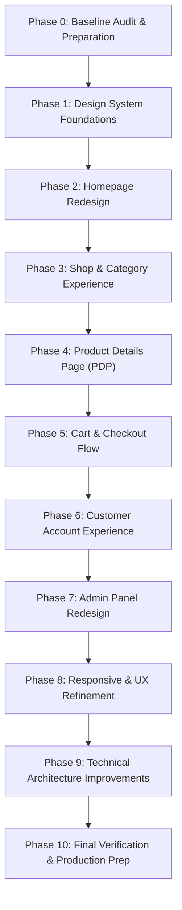

# SOLEVIBE — COMPLETE DEVELOPMENT ROADMAP (`planphase.md`)

> **Document Version:** 1.0.0  
> **Target Project:** SoleVibe Footwear E-Commerce Platform  
> **Status:** Authoritative Implementation Roadmap  
> **Execution Context:** Node.js v20+ / React 18 / Express 5 / MongoDB 8+  
> **Reference Documents:** `design.md` (Design Specification) & `archetrect.md` (Technical Architecture)

---

## Executive Summary & Strategic Approach

SoleVibe has an established, highly capable MERN backend with complete REST API coverage, robust Mongoose data schemas (14 models), persistent authentication, payment gateway hooks, multi-carrier shipping providers, and administrative capabilities. However, the client-facing user interface suffers from design inconsistencies, legacy dark-mode remnants, non-standard component sizing, and incomplete mobile refinement.

This roadmap outlines the systematic transformation of SoleVibe into a world-class footwear e-commerce experience. The aesthetic merges the **bold athletic energy of Nike**, the **crafted lifestyle presentation of New Balance**, and the **minimalist precision and technical micro-spacing of On Running**.

### Core Tenets of Execution
1. **Preservation Over Recreation:** Never rewrite working backend controllers, database schemas, or service APIs. Visual and UX enhancements must consume existing data contracts.
2. **Phase Isolation:** Work must proceed linearly through clearly defined phases. Each phase has explicit completion criteria and testing verification requirements.
3. **Decoupled Design Systems:** Maintain strict separation between the **Alabaster & Charcoal Light Canvas** of the customer storefront and the **Slate-Dark High-Productivity Interface** of the Admin Portal.
4. **Zero Downtime & Zero Regression:** At every step, customer cart persistence, guest-to-user hydration, address validation, and Razorpay checkout integrity must be verified.

---

## Phase-by-Phase Implementation Plan

---

### Phase 0: Baseline Audit and Preparation

#### 1. Objective
Establish an empirical baseline of application health, verify running dev daemons, document visual regressions and theme clashes in the existing UI, catalog all functional APIs, and configure test scaffolding to ensure zero regressions during future phases.

#### 2. Existing Files / Components to Inspect
- `package.json` (Dependencies and scripts)
- `src/App.js` & `src/App.css` (State orchestration, page routing, global layout)
- `src/index.css` & `src/index.js` (Root styles, base resets)
- `src/styles/design-tokens.css` & `src/styles/fashion-overrides.css` (Existing CSS tokens and legacy dark-theme overrides)
- `server/server.js` & `server/config/db.js` (Backend API listener and MongoDB connection)
- `src/services/api.js` (Axios configuration and error interceptors)

#### 3. Files Likely to be Modified
- `src/styles/design-tokens.css` (Prepending token comments and pruning deprecated styles)
- `src/App.css` (Resetting layout wrappers)
- `package.json` (Adding test scripts if required)

#### 4. Required Implementation Tasks
- [ ] Inspect running processes: Verify MongoDB (`127.0.0.1:27017`), backend API (`localhost:5001`), and React frontend (`localhost:3000`).
- [ ] Visual walkthrough: Document specific visual defects across all storefront views (`home`, `shop`, `product-detail`, `cart`, `orders`, `account`).
- [ ] Catalog broken CSS selectors: Identify conflicting color variables between `design-tokens.css`, `fashion-overrides.css`, and component `.css` files.
- [ ] Audit console errors: Inspect browser DevTools console and terminal logs for missing React keys, deprecated lifecycle hooks, or unhandled promise rejections.
- [ ] Verify test suite baseline: Execute backend automated endpoint tests and capture results.

#### 5. Dependencies on Earlier Phases
None. This is the foundational diagnostic phase.

#### 6. Existing Functionality That Must Be Preserved
- All existing API endpoints (`/api/*`).
- Backend server port configuration (`PORT=5001`) and MongoDB connection (`kinetic_stride`).
- Frontend development server hot-reload capabilities.

#### 7. Potential Risks
- Making premature CSS changes that disrupt active layout rendering before tokens are standardized.
- Unintentionally altering shared class names used across both admin and customer views.

#### 8. Testing Checklist
- [ ] `GET http://localhost:5001/api/health` returns `status: healthy` and database `connected`.
- [ ] `http://localhost:3000` loads without fatal JavaScript crashes.
- [ ] Backend test script executes without database write failures.
- [ ] All 18 routes respond without 404 or unhandled 500 errors.

#### 9. Clear Completion Criteria
A structured audit report documenting:
1. Operational status of database, API, and client runtime.
2. Comprehensive catalog of UI inconsistencies (e.g., contrasting dark banners on light cards, misaligned buttons).
3. Clean baseline git working tree ready for Phase 1.

---

### Phase 1: Design System Implementation

#### 1. Objective
Implement the complete visual design foundation specified in `design.md`, establishing the semantic color palette, typography hierarchy, responsive spacing scale, borders, elevations, and reusable primitive UI components.

#### 2. Existing Files / Components to Inspect
- `src/styles/design-tokens.css`
- `src/styles/fashion-overrides.css`
- `src/index.css`
- `src/App.css`
- `src/components/ProductCard.js` (Existing card markup)
- `src/components/Toast.css` (Existing notification styles)

#### 3. Files Likely to be Modified
- `src/styles/design-tokens.css` (Complete rewrite with semantic token structure)
- `src/styles/fashion-overrides.css` (Refinement to prevent visual conflicts)
- `src/index.css` (Web font imports, standard resets, typography rules)
- `src/App.css` (Global button, input, badge, and utility classes)

#### 4. Required Implementation Tasks
- [ ] Import Google Fonts: Primary sans-serif (`Inter`), Display/Headline typeface (`Space Grotesk`), and Monospace telemetry font (`JetBrains Mono`).
- [ ] Standardize Core Palette:
  - Canvas & Wash: `--color-white: #FFFFFF`, `--color-alabaster: #F9FAFB`, `--color-platinum: #F3F4F6`.
  - Hairlines & Borders: `--color-line-subtle: #E5E7EB`, `--color-line-strong: #D1D5DB`.
  - Typography: `--color-slate-900: #111827`, `--color-slate-800: #1F2937`, `--color-slate-600: #4B5563`, `--color-slate-400: #9CA3AF`.
  - Brand Accents: `--color-kinetic-red: #FF4D2E`, `--color-kinetic-hover: #E03E22`, `--color-racing-crimson: #C9232D`.
  - Telemetry Highlights: `--color-volt-lime: #D4FF00`, `--color-cyber-cyan: #00F0FF`.
- [ ] Establish 4px/8px Spacing Scale: Set `--space-1` (4px) through `--space-24` (96px).
- [ ] Implement Elevation Tokens: Subtly diffused modern shadows (`--shadow-sm`, `--shadow-md`, `--shadow-lg`, `--shadow-card`).
- [ ] Define Standard UI Classes:
  - Buttons: `.btn-primary` (Kinetic Vermilion), `.btn-secondary` (Dark Charcoal), `.btn-outline` (Hairline border), `.btn-ghost`.
  - Form Inputs: `.input-field` (Alabaster background, hairline border, focus ring `#FF4D2E`).
  - Badges & Telemetry Chips: `.badge-telemetry`, `.badge-sale`, `.badge-new`.

#### 5. Dependencies on Earlier Phases
Requires completion of Phase 0 audit to avoid overwriting active styles blindly.

#### 6. Existing Functionality That Must Be Preserved
- Admin dashboard styles must not be broken by global resets.
- Existing class names relied upon by `ProductCard.js`, `Navbar.js`, and `Cart.js` must maintain fallback compatibility.

#### 7. Potential Risks
- Specificity collisions between `design-tokens.css` and existing inline or scoped component CSS files.
- Font loading delay causing Flash of Unstyled Text (FOUT).

#### 8. Testing Checklist
- [ ] Verify font stack renders properly across all major headings (`h1` through `h6`) and body copy.
- [ ] Test button hover, focus, active, and disabled states.
- [ ] Check input fields for high-contrast focus rings and accessible placeholder text.
- [ ] Verify light canvas background (`#F9FAFB`) renders uniformly without dark bleed-through.

#### 9. Clear Completion Criteria
`src/styles/design-tokens.css` completely updated and verified against `design.md`. Standardized button, input, and badge styles actively functioning and visually inspected on a test preview canvas.

---

### Phase 2: Homepage Redesign

#### 1. Objective
Redesign the primary storefront landing page to project athletic luxury and high-performance storytelling, combining the dynamic energy of Nike with the minimal precision of On Running.

#### 2. Existing Files / Components to Inspect
- `src/components/Navbar.js` & `src/components/Navbar.css`
- `src/components/HomePage.js` & `src/components/HomePage.css`
- `src/components/Hero3D.js` & `src/components/Hero3D.css`
- `src/components/Footer.js` & `src/components/Footer.css`
- `src/components/RecentlyViewed.js` & `src/components/RecentlyViewed.css`
- `src/components/ProductCard.js`

#### 3. Files Likely to be Modified
- `src/components/Navbar.js` & `src/components/Navbar.css`
- `src/components/HomePage.js` & `src/components/HomePage.css`
- `src/components/Footer.js` & `src/components/Footer.css`
- `src/components/Hero3D.js` (Performance and layout refinement)

#### 4. Required Implementation Tasks
- [ ] **Announcement Bar:** Rotating or marquee banner (`Free shipping on orders over ₹2,000`, `30-Day Biomechanical Wear Trial`).
- [ ] **Modern Navbar:**
  - Crisp white/translucent sticky navbar with subtle border.
  - Bold wordmark `SOLE` (`#111827`) + `VIBE` (`#FF4D2E`).
  - Category navigation links (`Men`, `Women`, `Running`, `Racing`, `Sale`).
  - Search trigger, Wishlist counter pill, Cart counter pill with item badges.
  - Customer account profile trigger or login button.
- [ ] **High-Impact Hero Section:**
  - Bold typography: *"ENGINEERED FOR PEAK VELOCITY"*.
  - Three.js 3D Interactive Shoe Canvas or high-definition performance visual banner.
  - Primary CTA *"Explore Collection"* & Secondary CTA *"Watch Technology"*.
  - Telemetry badge overlay (e.g., `Drop: 8mm | Cushion: NitroFoam | Weight: 215g`).
- [ ] **Curated Category Grid:** Visual cards for Men, Women, Road Running, Trail Running, and Racing.
- [ ] **Trending / Featured Showcase:** Carousel/grid powered by `productService.getAll()` showing featured models.
- [ ] **Brand Storytelling / Biomechanics Section:** Split-screen editorial showcasing SoleVibe propulsion plate technology and nitrogen-infused midsole foam.
- [ ] **Customer Testimonials:** Verified runner quotes with star ratings.
- [ ] **Newsletter Bar:** Minimalist subscription input with micro-privacy statement.
- [ ] **Footer:** Multi-column layout covering Categories, Customer Care, About SoleVibe, Legal, and Social links.

#### 5. Dependencies on Earlier Phases
Requires Phase 1 (Design System & Tokens) for colors, typography, buttons, and spacing.

#### 6. Existing Functionality That Must Be Preserved
- `setCurrentPage` navigation dispatches (`home`, `shop`, `men`, `women`, `cart`, `wishlist`, `account`, `login`).
- Search input triggering catalog search query state in `App.js`.
- Cart and wishlist item counts accurately reflecting live state.
- Three.js 3D canvas interaction controls (`@react-three/fiber` orbit controls).

#### 7. Potential Risks
- Three.js WebGL canvas causing mobile frame rate drops if not properly unmounted or memoized.
- Mega-menu hover overlays blocking underlying click events.

#### 8. Testing Checklist
- [ ] Navbar sticky scroll behavior transitions smoothly with subtle box-shadow.
- [ ] Category links navigate to correct filtered views.
- [ ] Cart and wishlist badges update reactively when items are added.
- [ ] Three.js 3D canvas rotates cleanly on drag without memory leaks.
- [ ] Newsletter form validates email input.
- [ ] Footer links trigger appropriate page transitions.

#### 9. Clear Completion Criteria
Homepage fully renders with the new light aesthetic, typography, and sections. All interactive links and data fetches function properly with zero console errors.

---

### Phase 3: Shop and Category Pages

#### 1. Objective
Deliver a high-conversion product catalog experience with intuitive filtering, multi-attribute sorting, fast keyword search, and standardized product cards.

#### 2. Existing Files / Components to Inspect
- `src/components/CollectionPage.js` & `src/components/CollectionPage.css`
- `src/components/ProductCard.js`
- `src/components/ProductSkeleton.js`
- `src/components/QuickViewModal.js` & `src/components/QuickViewModal.css`
- `src/services/productService.js`
- `src/services/categoryService.js`

#### 3. Files Likely to be Modified
- `src/components/CollectionPage.js` & `src/components/CollectionPage.css`
- `src/components/ProductCard.js`
- `src/components/ProductSkeleton.js`
- `src/components/QuickViewModal.js` & `src/components/QuickViewModal.css`

#### 4. Required Implementation Tasks
- [ ] **Page Header & Category Breadcrumbs:** Dynamic title reflecting active category, product count, and short editorial description.
- [ ] **Refined Product Card (`ProductCard.js`):**
  - Standardized 4:5 vertical aspect ratio.
  - Image hover zoom and secondary gallery image preview on mouse enter.
  - Subtle floating badges: `NEW`, `BESTSELLER`, or discount percent (`-25%`).
  - Floating Quick-View trigger button and Wishlist heart toggle.
  - Shoe title in Slate 900, category tag, and price display (`₹Price` with strikethrough `originalPrice`).
  - Telemetry spec tag (e.g., `Carbon Plate`, `Nitro Foam`).
- [ ] **Filter Sidebar (Desktop Sticky / Mobile Drawer):**
  - Category / Gender checkboxes (`Men`, `Women`, `Unisex`).
  - Shoe Type (`Road Running`, `Trail`, `Racing`, `Training`).
  - Size Filter (UK 6, 7, 8, 9, 10, 11, 12).
  - Price Range Slider with min/max bounds.
  - In-Stock Only toggle switch.
  - "Clear All Filters" button.
- [ ] **Sorting Control:** Clean select dropdown (`Featured`, `Price: Low to High`, `Price: High to Low`, `Newest Arrivals`, `Customer Rating`).
- [ ] **Product Skeleton Loader (`ProductSkeleton.js`):** Shimmer animation matching the exact dimensions of the 4:5 product cards.
- [ ] **Empty State:** High-contrast editorial illustration with "No shoes found" messaging and suggested popular collections.
- [ ] **Quick View Modal (`QuickViewModal.js`):** Seamless modal preview displaying image gallery, size selector, and rapid "Add to Bag" action.

#### 5. Dependencies on Earlier Phases
Requires Phase 1 (Tokens) and Phase 2 (Navbar integration).

#### 6. Existing Functionality That Must Be Preserved
- `productService.getAll(params)` query parameters (`category`, `gender`, `search`, `minPrice`, `maxPrice`, `sort`).
- `window.dispatchEvent(new CustomEvent('openProductDetail', { detail: product }))` for opening product detail views.
- Wishlist toggling and state persistence.
- Quick view modal state management.

#### 7. Potential Risks
- State desynchronization between mobile drawer filters and desktop sidebar filters.
- Slow filter re-renders if product lists are not memoized.

#### 8. Testing Checklist
- [ ] Filtering by gender, category, and size returns accurate subsets from MongoDB.
- [ ] Price slider limits catalog display accurately.
- [ ] Sorting orders products correctly by price and creation date.
- [ ] Clicking a product card navigates to ProductDetail.
- [ ] Wishlist toggle adds/removes item and updates navbar counter.
- [ ] Skeleton loaders display during API latency.

#### 9. Clear Completion Criteria
Shop and category views render cleanly with the 4:5 card layout, fully functional sidebar filters, reactive sorting, and zero visual glitches.

---

### Phase 4: Product Details Page (PDP)

#### 1. Objective
Engineer an editorial, informative, and friction-free Product Details Page that communicates technical performance metrics, provides sizing confidence, and maximizes conversion.

#### 2. Existing Files / Components to Inspect
- `src/components/ProductDetail.js` & `src/components/ProductDetail.css`
- `src/services/productService.js`
- `src/services/reviewService.js`
- `src/components/RecentlyViewed.js`

#### 3. Files Likely to be Modified
- `src/components/ProductDetail.js` & `src/components/ProductDetail.css`
- `src/components/RecentlyViewed.js` & `src/components/RecentlyViewed.css`

#### 4. Required Implementation Tasks
- [ ] **Sticky Media Gallery (Left Column):**
  - High-resolution main image showcase with smooth zoom on hover.
  - Thumbnail reel (supporting 4+ gallery images from `product.images`).
  - Badge overlay (`ENGINEERED FOR RACING`, `BESTSELLER`).
- [ ] **Product Information Suite (Right Column):**
  - Brand mark & collection name.
  - Headline shoe name in bold Slate 900 (`Space Grotesk`).
  - Price block: Bold current price, strikethrough original price, and savings badge.
  - Star rating with direct link to reviews section.
  - Rich markdown/HTML product description.
- [ ] **Biomechanical Telemetry Chips:**
  - Micro-spec pill grid displaying:
    - *Weight:* e.g., `210g (UK 8)`
    - *Heel-to-Toe Drop:* e.g., `8mm`
    - *Midsole Tech:* e.g., `Dual-Density NitroFoam`
    - *Plate Type:* e.g., `Curved Carbon-Fiber Propulsion Plate`
- [ ] **Size Selection & Size Guide:**
  - Interactive UK size pill buttons (`UK 7`, `UK 8`, `UK 9`, `UK 10`, `UK 11`).
  - Out-of-stock size disabling with strike-through visual indicator.
  - "Size Guide" modal link providing foot length (cm/inches) and conversion charts.
- [ ] **Action Suite:**
  - Primary CTA: *"Add to Bag"* (`.btn-primary`, Kinetic Vermilion).
  - Secondary CTA: *"Buy Now"* (instant checkout transition).
  - Favorite / Wishlist heart button with active state fill.
- [ ] **Value Propositions:** Delivery estimates, 30-day wear trial guarantee, free returns statement.
- [ ] **Customer Reviews & Moderation Section:**
  - Average rating breakdown (1 to 5 stars).
  - Verified buyer badge on reviews.
  - Review submission form (rating, review title, detailed comment).
- [ ] **Related & Recently Viewed Shoes:** Dynamic carousel powered by `RecentlyViewed.js`.

#### 5. Dependencies on Earlier Phases
Requires Phase 1 (Tokens) and Phase 3 (ProductCard patterns).

#### 6. Existing Functionality That Must Be Preserved
- `addToCart(product, quantity, size)` integration with backend cart API and guest storage.
- Instant checkout transition for "Buy Now".
- Review submission via `reviewService.createReview()`.
- Recently viewed shoe persistence in `localStorage`.

#### 7. Potential Risks
- Customers attempting to add products to the cart without selecting a size. A clear validation error state must be displayed.
- Missing images causing broken layout grids. Graceful placeholder fallbacks must be in place.

#### 8. Testing Checklist
- [ ] Size selection required before adding to cart; displays validation toast if omitted.
- [ ] Clicking "Add to Bag" adds item with selected size to cart and updates navbar count.
- [ ] Clicking "Buy Now" adds item and transitions directly to checkout/cart.
- [ ] Thumbnail clicks smoothly switch the active hero image.
- [ ] Review submission persists to MongoDB and appears in list upon approval.
- [ ] Out of stock sizes cannot be selected.

#### 9. Clear Completion Criteria
PDP fully matches the `design.md` specifications with working gallery zoom, size selector, telemetry chips, reviews, and flawless cart dispatch.

---

### Phase 5: Cart and Checkout

#### 1. Objective
Deliver a seamless, trustworthy shopping bag and checkout experience with transparent order calculations, address selection, coupon application, and Razorpay payment execution.

#### 2. Existing Files / Components to Inspect
- `src/components/Cart.js` & `src/components/Cart.css`
- `src/components/AddressBook.js` & `src/components/AddressBook.css`
- `src/components/AddressForm.js`
- `src/components/OrderConfirmation.js` & `src/components/OrderConfirmation.css`
- `src/services/cartService.js`
- `src/services/couponService.js`
- `src/services/shippingService.js`
- `src/services/paymentService.js`
- `src/services/orderService.js`

#### 3. Files Likely to be Modified
- `src/components/Cart.js` & `src/components/Cart.css`
- `src/components/AddressBook.js` & `src/components/AddressBook.css`
- `src/components/AddressForm.js`
- `src/components/OrderConfirmation.js` & `src/components/OrderConfirmation.css`

#### 4. Required Implementation Tasks
- [ ] **Shopping Bag Interface (`Cart.js`):**
  - Left column: Detailed list of bag items (thumbnail, shoe title, selected UK size, unit price, quantity stepper `[-] 1 [+]`, remove item trash icon).
  - Right column: Sticky Order Summary card.
  - Subtotal calculation, discount line, dynamic shipping fee line, and final total.
- [ ] **Promotional Coupon Engine:**
  - Clean coupon input field with *"Apply"* button.
  - Calls `couponService.validateCoupon()`; displays active discount with remove button.
- [ ] **Delivery Address Selector (`AddressBook.js` / `AddressForm.js`):**
  - Card-based selector for authenticated users with default address pre-selected.
  - Inline "Add New Delivery Address" modal/form.
  - Strict validation: 6-digit Indian PIN code and 10-digit mobile number.
- [ ] **Shipping Rate Calculation:**
  - Real-time calculation via `/api/shipping/calculate` based on subtotal and PIN code.
  - Displays free shipping qualification threshold banner (e.g., *"Add ₹450 more for Free Delivery"*).
- [ ] **Payment Method & Razorpay Integration:**
  - Payment method choices: Online Payment (Razorpay: UPI, Cards, Netbanking) and Cash on Delivery (if enabled).
  - Razorpay checkout modal launch with order creation (`/api/payment/create-order`).
  - Signature verification (`/api/payment/verify`) and automatic order persistence.
- [ ] **Order Confirmation Page (`OrderConfirmation.js`):**
  - Congratulatory order header with checkmark animation.
  - Order reference number (`SV-XXXXXX`), order summary, delivery address snapshot.
  - Estimated delivery date range and tracking link.
  - "Continue Shopping" CTA.

#### 5. Dependencies on Earlier Phases
Requires Phase 1 (Tokens) and Phase 4 (Cart population from PDP).

#### 6. Existing Functionality That Must Be Preserved
- Backend cart synchronization for authenticated users via `cartService`.
- LocalStorage guest cart synchronization.
- Phone/PIN validation logic in `Address.js` and `AddressForm.js`.
- Razorpay HMAC verification and transaction logging in `PaymentTransaction`.
- Automatic inventory deduction on order creation.

#### 7. Potential Risks
- Payment modal closure mid-transaction resulting in orphaned orders or unpaid records.
- Network latency during shipping rate calculation freezing the checkout submit button.

#### 8. Testing Checklist
- [ ] Increasing/decreasing quantity updates subtotal in real time.
- [ ] Removing an item prompts confirmation and removes from MongoDB cart.
- [ ] Valid coupon code reduces total; invalid code displays error toast.
- [ ] Creating an address validates Indian phone (`+91` or 10 digits) and 6-digit PIN.
- [ ] Payment execution completes via Razorpay (or mock mode in dev) and renders OrderConfirmation.
- [ ] Database verifies order record exists in `orders` collection with status `'confirmed'`.

#### 9. Clear Completion Criteria
Complete shopping bag and checkout workflow functions end-to-end with accurate tax/shipping calculations, address selection, Razorpay modal launch, and order confirmation generation.

---

### Phase 6: Customer Account Experience

#### 1. Objective
Deliver a unified, self-service customer portal where users can manage profiles, track orders, request returns, organize wishlists, and manage delivery addresses.

#### 2. Existing Files / Components to Inspect
- `src/components/Login.js` & `src/components/Login.css`
- `src/components/CustomerAccount.js` & `src/components/CustomerAccount.css`
- `src/components/OrderHistory.js` & `src/components/OrderHistory.css`
- `src/components/Wishlist.js` & `src/components/Wishlist.css`
- `src/components/AddressBook.js` & `src/components/AddressBook.css`
- `src/components/NotificationCenter.js` & `src/components/NotificationCenter.css`
- `src/services/authService.js`
- `src/services/orderService.js`
- `src/services/returnService.js`

#### 3. Files Likely to be Modified
- `src/components/Login.js` & `src/components/Login.css`
- `src/components/CustomerAccount.js` & `src/components/CustomerAccount.css`
- `src/components/OrderHistory.js` & `src/components/OrderHistory.css`
- `src/components/Wishlist.js` & `src/components/Wishlist.css`
- `src/components/NotificationCenter.js` & `src/components/NotificationCenter.css`

#### 4. Required Implementation Tasks
- [ ] **Modern Authentication Modal / View (`Login.js`):**
  - Tabbed interface switching between *"Sign In"* and *"Create Account"*.
  - Show/hide password toggle.
  - Form validation with clear error messaging.
- [ ] **Customer Account Dashboard (`CustomerAccount.js`):**
  - Left navigation sidebar: *Overview*, *My Orders*, *Wishlist*, *Saved Addresses*, *Returns & Refunds*, *Notifications*, *Settings*.
  - Overview screen: Welcome greeting, lifetime orders summary, default address preview, quick link to latest order status.
- [ ] **Order History & Tracking (`OrderHistory.js`):**
  - List of past orders with date, order ID, total, and status pill (`Confirmed`, `Shipped`, `Delivered`).
  - Progress tracker showing fulfillment stages.
  - Expanded order modal showing line items, tracking number, carrier, and invoice download.
  - "Request Return" action on eligible delivered items.
- [ ] **Return Management Experience:**
  - Return request modal (select items, select reason e.g. `WRONG_SIZE`, `DEFECTIVE`, enter description).
  - Status display of active returns (`REQUESTED`, `APPROVED`, `REFUNDED`).
- [ ] **Wishlist Grid (`Wishlist.js`):**
  - 4-column card grid of saved items with quick "Move to Bag" button and remove icon.
- [ ] **In-App Notification Center (`NotificationCenter.js`):**
  - Dropdown or tabbed panel displaying order status alerts and abandoned cart reminders.
  - "Mark All as Read" action.

#### 5. Dependencies on Earlier Phases
Requires Phase 1 (Tokens) and Phase 5 (Orders placed to populate history).

#### 6. Existing Functionality That Must Be Preserved
- JWT authentication lifecycle and token storage.
- Password change API endpoint (`/api/auth/update-password`).
- Return creation API (`/api/returns`) and validation.
- Notification reading and unread count badges.

#### 7. Potential Risks
- Session expiry causing silent API failures inside account tabs.
- Long order histories degrading client render performance without pagination.

#### 8. Testing Checklist
- [ ] Login and registration function with proper token storage in `localStorage`.
- [ ] Order history displays all orders previously created by the user.
- [ ] Submitting a return request sets status to `REQUESTED` and appears in account view.
- [ ] Wishlist "Move to Bag" adds product to cart and removes from wishlist.
- [ ] Updating profile name persists to MongoDB via `/api/auth/profile`.

#### 9. Clear Completion Criteria
Customer account hub fully styled and operational across all tabs with working order history, returns tracking, address management, and notification toggling.

---

### Phase 7: Admin Panel Redesign

#### 1. Objective
Elevate the administrative interface into a high-productivity, dark-slate workspace (`#0F172A`) providing store operators with real-time analytics, catalog control, order fulfillment, inventory management, and return processing.

#### 2. Existing Files / Components to Inspect
- `src/components/AdminDashboard.js` & `src/components/AdminDashboard.css`
- All files in `src/components/admin/`:
  - `AdminLayout.js` / `.css`
  - `Dashboard.js` / `.css`
  - `ProductsManager.js` / `.css`
  - `CategoriesManager.js` / `.css`
  - `OrdersManager.js` / `.css`
  - `CustomersManager.js` / `.css`
  - `InventoryManager.js` / `.css`
  - `CouponsManager.js` / `.css`
  - `ReturnsManager.js` / `.css`
  - `ReviewsManager.js` / `.css`
  - `AdminSettings.js` / `.css`
  - `ProductFormModal.js` / `.css`
  - `ConfirmationModal.js` / `.css`

#### 3. Files Likely to be Modified
- `src/components/admin/AdminLayout.js` & `AdminLayout.css`
- `src/components/admin/Dashboard.js` & `Dashboard.css`
- `src/components/admin/ProductsManager.js` & `ProductsManager.css`
- `src/components/admin/OrdersManager.js` & `OrdersManager.css`
- `src/components/admin/InventoryManager.js` & `InventoryManager.css`
- `src/components/admin/CategoriesManager.js` & `CategoriesManager.css`
- `src/components/admin/ReturnsManager.js` & `ReturnsManager.css`
- `src/components/admin/AdminSettings.js` & `AdminSettings.css`

#### 4. Required Implementation Tasks
- [ ] **Admin Theme Architecture:** Implement dedicated dark slate palette (`#0B0F19`, `#0F172A`, `#1E293B`, `#334155`) strictly isolated from customer storefront CSS.
- [ ] **Admin Sidebar Navigation (`AdminLayout.js`):**
  - Collapsible sidebar with brand wordmark and operator profile.
  - Nav items: *Overview*, *Products*, *Categories*, *Orders*, *Customers*, *Inventory*, *Coupons*, *Returns*, *Reviews*, *Settings*.
  - Real-time badge indicators (e.g., pending orders count, low stock alert count).
  - Quick action: "View Storefront" link opening customer store in new tab.
- [ ] **Executive Analytics Dashboard (`Dashboard.js`):**
  - Metric cards: Gross Revenue, Total Orders, Average Order Value, Customer Growth.
  - Visual sales trends and low-stock warning banners.
- [ ] **Product Catalog Management (`ProductsManager.js` / `ProductFormModal.js`):**
  - Tabular list with thumbnail, shoe name, SKU, price, stock count, and active status switch.
  - Modal for product creation and editing.
  - Image upload integration (Cloudinary or local `/uploads/`).
  - Biomechanical specifications input fields (Weight, Drop, Cushioning, Material).
- [ ] **Category Hierarchy Manager (`CategoriesManager.js`):**
  - Slug generation, display order controls, parent-child category relationships, SEO title/description inputs.
- [ ] **Order Fulfillment Console (`OrdersManager.js`):**
  - Filter orders by status (`confirmed`, `processing`, `shipped`, `delivered`, `cancelled`).
  - Order detail inspection (customer contact, delivery address, line items).
  - Status progression buttons with carrier selection and tracking number assignment.
- [ ] **Inventory Control & Ledger (`InventoryManager.js`):**
  - Stock adjustment modal (`STOCK_IN`, `ADJUSTMENT`, `DAMAGE`) with audit note requirement.
  - Audit history log displaying chronological transactions from `InventoryTransaction`.
- [ ] **Returns & Refund Console (`ReturnsManager.js`):**
  - Review submitted return reasons and inspect evidence photos.
  - Status updater (`APPROVED`, `REJECTED`, `RECEIVED`).
  - Integrated Razorpay refund execution button.
- [ ] **Store Configuration (`AdminSettings.js`):**
  - Singleton settings manager: store name, contact info, shipping fee thresholds, GST rate.

#### 5. Dependencies on Earlier Phases
Requires Phase 1 (Tokens) and Phase 0 (Audit). Must maintain independent CSS scoping.

#### 6. Existing Functionality That Must Be Preserved
- All admin RBAC requirements (`authorize('ADMIN')`).
- File upload handlers in `uploadController.js`.
- Inventory transaction audit logging.
- Settings document persistence in MongoDB.

#### 7. Potential Risks
- Leaking admin dark-mode styles into customer light-mode storefront pages. Scoping must be strictly enforced via `.admin-container` root wrapper.
- Accidental inventory mismatches if adjustment validation is bypassed.

#### 8. Testing Checklist
- [ ] Navigating to `/admin` as a standard user redirects or blocks access.
- [ ] Logging in as `admin@solevibe.com` renders the dark administrative portal.
- [ ] Product creation successfully uploads image and creates record with auto-generated SKU.
- [ ] Updating order status from `confirmed` to `shipped` persists status history.
- [ ] Adjusting stock increments/decrements inventory and records transaction in ledger.
- [ ] Saving store settings updates MongoDB and retains values across server restart.

#### 9. Clear Completion Criteria
Admin portal fully styled in high-productivity dark slate with zero style leaks into the customer store. All 10 manager panels operational and connected to live backend APIs.

---

### Phase 8: Responsive Design and UX Refinement

#### 1. Objective
Ensure flawless cross-device performance, smooth touch-friendly mobile shopping, accessibility compliance, and micro-interaction polish across all screen viewports.

#### 2. Existing Files / Components to Inspect
- `src/App.css` & `src/index.css`
- `src/components/Navbar.js` & `Navbar.css`
- `src/components/HomePage.js` & `HomePage.css`
- `src/components/CollectionPage.js` & `CollectionPage.css`
- `src/components/ProductDetail.js` & `ProductDetail.css`
- `src/components/Cart.js` & `Cart.css`

#### 3. Files Likely to be Modified
- Component stylesheets across storefront (`Navbar.css`, `HomePage.css`, `CollectionPage.css`, `ProductDetail.css`, `Cart.css`)
- `src/App.css` (Responsive breakpoint media queries)

#### 4. Required Implementation Tasks
- [ ] **Mobile Navigation Drawer:**
  - Smooth slide-out mobile drawer with brandmark, category navigation, account links, and currency indicator.
  - Backdrop blur overlay on active drawer.
- [ ] **Mobile Bottom Navigation Bar:**
  - Sticky bottom navigation bar for mobile viewports (`< 768px`) with icons for *Home*, *Shop*, *Bag* (with badge), *Wishlist*, and *Account*.
- [ ] **Touch Optimization:**
  - Ensure all clickable targets meet the minimum 44x44px touch target standard.
  - Native momentum scrolling for carousels and product thumbnail reels.
- [ ] **Mobile Sticky PDP Action Bar:**
  - Sticky bottom purchase bar on mobile PDP when user scrolls past the main buy button, displaying shoe thumbnail, price, and rapid "Add to Bag" trigger.
- [ ] **Responsive Breakpoint Verification:**
  - Mobile Small: 360px – 480px.
  - Mobile Large / Phablet: 481px – 767px.
  - Tablet: 768px – 1023px.
  - Desktop Standard: 1024px – 1439px.
  - Large Display: 1440px+.
- [ ] **Typography Clamping:** Apply CSS `clamp()` for fluid responsive headings that scale smoothly across devices without abrupt layout shifts.
- [ ] **Accessibility (WCAG AA):**
  - Verify contrast ratio of minimum 4.5:1 for body copy and 3.0:1 for large display titles.
  - Ensure all icons and buttons possess descriptive `aria-label` tags.
  - Ensure clear keyboard focus outlines on interactive elements.

#### 5. Dependencies on Earlier Phases
Requires completion of customer-facing views (Phases 1 through 6).

#### 6. Existing Functionality That Must Be Preserved
- All touch and click event listeners across customer views.
- Three.js canvas responsiveness and aspect ratio handling on window resize.

#### 7. Potential Risks
- Mobile bottom navigation obscuring checkout action buttons or cookie banners.
- Layout shifts (CLS) on mobile when high-resolution images load.

#### 8. Testing Checklist
- [ ] Mobile drawer opens and closes smoothly on iOS Safari and Android Chrome simulations.
- [ ] Sticky bottom action bar appears on mobile PDP upon scroll.
- [ ] 2-column product grid renders cleanly on 375px mobile screens without overflow.
- [ ] Form inputs do not auto-zoom on iOS (font-size >= 16px on inputs).
- [ ] Keyboard navigation (Tab / Shift+Tab) traverses page logically with visible focus rings.

#### 9. Clear Completion Criteria
Storefront renders responsively and smoothly across all target breakpoints with zero horizontal scrollbars, verified touch targets, and WCAG AA contrast compliance.

---

### Phase 9: Technical Improvements

#### 1. Objective
Evaluate and strategically execute high-impact architectural refinements identified in `archetrect.md` to enhance performance, reliability, and code maintainability without introducing unnecessary complexity.

#### 2. Existing Files / Components to Inspect
- `src/App.js` (State routing architecture)
- `server/server.js` (Middleware, static file delivery, cron execution)
- `server/services/abandonedCartService.js` (In-memory cron scheduler)
- `server/controllers/uploadController.js` (Image persistence logic)
- `package.json` (Dependency consolidation)

#### 3. Files Likely to be Modified
- `src/App.js` & potential routing files
- `server/server.js`
- `server/controllers/uploadController.js`

#### 4. Required Implementation Tasks & Technical Evaluation

##### A. Routing Evaluation (State-Driven vs. React Router)
- *Assessment:* The existing state-driven routing (`currentPage`) provides fast view switching but prevents bookmarking, deep URLs, and native browser back/forward history.
- *Action Plan:* Evaluate migrating to `react-router-dom` v6 for primary customer routes (`/`, `/shop`, `/product/:slug`, `/cart`, `/account`, `/admin`). If full router migration introduces risk to current sprint deadlines, implement a lightweight HTML5 History API bridge (`window.history.pushState`) inside `App.js` to sync URL paths with `currentPage` states safely without breaking existing component contracts.

##### B. Cloud Image Storage & CDN Optimization
- *Assessment:* Local `/uploads` storage is ephemeral in cloud container environments.
- *Action Plan:* Ensure `.env` includes verified Cloudinary credentials or S3 hooks so production image uploads always persist to cloud storage. Implement lazy loading (`loading="lazy"`) and `srcset` attributes on product images.

##### C. Background Job Resilience
- *Assessment:* In-memory `setInterval` for abandoned carts resets on process restarts.
- *Action Plan:* Refactor `abandonedCartService.js` to ensure lock safety so duplicate notifications are never emitted, and document Redis/BullMQ worker configuration for production scaling.

##### D. HTTP Response Caching
- *Assessment:* Repeated catalog queries hit MongoDB directly.
- *Action Plan:* Add HTTP caching headers (`Cache-Control: public, max-age=300`) to public catalog endpoints (`/api/products`, `/api/categories`, `/api/settings`) to reduce database load.

#### 5. Dependencies on Earlier Phases
Requires completion of all functional UI phases (Phases 1 through 8).

#### 6. Existing Functionality That Must Be Preserved
- All existing API route signatures and response schemas.
- Existing component props and state contracts.

#### 7. Potential Risks
- Disrupting active page state transitions if routing architecture is overhauled recklessly.
- Cache invalidation lag during admin product updates if cache headers are set too aggressively.

#### 8. Testing Checklist
- [ ] Browser back/forward navigation tested and verified.
- [ ] Image uploads tested with cloud fallback validation.
- [ ] Cache headers verified via browser network panel inspecting response headers.
- [ ] Abandoned cart scheduler verified to run without memory leaks.

#### 9. Clear Completion Criteria
Selected high-priority technical optimizations safely implemented, documented, and verified with zero architectural regressions.

---

### Phase 10: Final Testing and Production Preparation

#### 1. Objective
Perform exhaustive end-to-end user journey verification, admin workflow auditing, payment gateway checks, security verification, and production build readiness sign-off.

#### 2. Existing Files / Components to Inspect
- Entire codebase (`src/`, `server/`, `.env`, `package.json`)
- Production build output (`build/`)
- Backend test scripts

#### 3. Files Likely to be Modified
- `.env.example` (Ensuring all production environment variable keys are documented)
- Final bug fix adjustments across any component or controller

#### 4. Required Implementation Tasks
- [ ] **End-to-End Customer Journey Verification:**
  - Journey 1: Guest visits home -> filters running shoes in shop -> quick-views shoe -> views detail page -> selects size -> adds to bag -> signs up -> adds address -> completes checkout -> receives confirmation.
  - Journey 2: Customer logs in -> adds shoe to wishlist -> moves wishlist item to cart -> applies discount coupon -> checks out -> views order in account history.
  - Journey 3: Customer requests return on delivered order -> selects reason -> views return status in account dashboard.
- [ ] **Admin Operations Verification:**
  - Journey 4: Admin logs in -> creates new shoe product with image upload -> verifies shoe appears in storefront catalog -> updates stock level in inventory manager -> inspects audit ledger.
  - Journey 5: Admin inspects customer return request -> approves return -> triggers Razorpay refund -> verifies payment transaction ledger.
  - Journey 6: Admin updates store settings (free shipping threshold) -> verifies customer cart reflects updated threshold.
- [ ] **Payment & Webhook Integrity:**
  - Verify Razorpay test mode execution.
  - Verify webhook HMAC signature verification and idempotency handling (duplicate event rejection).
- [ ] **Security & Configuration Audit:**
  - Verify all passwords are encrypted with bcrypt (salt 12).
  - Verify JWT token rejection upon expiration or user deactivation.
  - Verify sensitive secrets (`JWT_SECRET`, `RAZORPAY_KEY_SECRET`) are never exposed in client bundles.
  - Verify Helmet security headers and CORS protection.
- [ ] **Production Build Compilation:**
  - Run `npm run build` and verify that the production bundle builds cleanly with zero compilation errors.

#### 5. Dependencies on Earlier Phases
Requires completion of all preceding phases (Phase 0 through Phase 9).

#### 6. Existing Functionality That Must Be Preserved
The entire platform in its complete, integrated, production-ready form.

#### 7. Potential Risks
- Discovering late-stage edge case bugs during end-to-end checkout. Must allow buffer for surgical fixes.

#### 8. Testing Checklist
- [ ] Production build succeeds (`Compiled successfully`).
- [ ] Zero critical errors in browser console across all customer and admin views.
- [ ] All 14 database collections accurately reflect test transactions.
- [ ] Performance audit: Lighthouse score targets met (>85 Performance, >90 Accessibility, >90 Best Practices).

#### 9. Clear Completion Criteria
A definitive verification matrix showing 100% test pass rate across all customer journeys, admin operations, security requirements, and production build verification.

---

## Strict Development Rules & Quality Standards

1. **Architecture Fidelity:** Adhere strictly to the existing React 18, Express 5, and Mongoose 9 foundation documented in `archetrect.md`.
2. **Design System Fidelity:** Every color swatch, font family, border radius, and spacing unit must derive directly from `design.md`.
3. **No Unsanctioned Dependencies:** Do not install heavy external libraries without explicit necessity.
4. **No Mock Data in Production:** All product listings, reviews, orders, and addresses must query live MongoDB collections. Mock providers are strictly reserved for local development fallbacks when third-party API credentials are not set.
5. **Separation of Concerns:** Customer storefront styling must never pollute the administrative dashboard, and admin styles must never alter the customer storefront.
6. **Execution Discipline:** Follow the mandatory development loop:  
   $$\text{Plan} \longrightarrow \text{Inspect} \longrightarrow \text{Implement} \longrightarrow \text{Test} \longrightarrow \text{Verify} \longrightarrow \text{Report} \longrightarrow \text{Approval} \longrightarrow \text{Next Phase}$$

---

## Phase Execution Matrix & Delivery Milestones

| Phase | Title | Primary Focus | Key Deliverable |
| :---: | :--- | :--- | :--- |
| **0** | Baseline Audit & Prep | Diagnostics & Health Baseline | Audit findings report & test scaffolding |
| **1** | Design System Foundations | CSS Tokens, Fonts, UI Primitives | Updated `design-tokens.css` & button/input classes |
| **2** | Homepage Redesign | High-Impact Brand Storytelling | Modern Navbar, Hero, Categories, Showcase, Footer |
| **3** | Shop & Category Experience | Catalog Discovery & Conversion | 4:5 Card Grid, Sticky Filters, Skeletons, Quick View |
| **4** | Product Details Page (PDP) | Biomechanics & Sizing Confidence| Dual-pane layout, Micro-specs, Size Guide, Reviews |
| **5** | Cart & Checkout Flow | Zero-Friction Purchasing | Line Items, Coupon Engine, Address Selector, Razorpay |
| **6** | Customer Account Experience| Self-Service Customer Hub | Auth Modal, Order History, Returns, Wishlist Grid |
| **7** | Admin Panel Redesign | High-Productivity Workspace | Dark Slate Portal, Catalog CRUD, Orders, Ledger |
| **8** | Responsive & UX Refinement | Mobile Excellence & Accessibility| Mobile Drawer, Bottom Nav, Touch Targets, WCAG AA |
| **9** | Technical Improvements | Reliability & Architecture | URL Sync/Routing, Caching, Cloud Storage, Background Jobs |
| **10**| Final Testing & Sign-off | Production Readiness & Audit | End-to-End Verification Matrix & Production Build |
